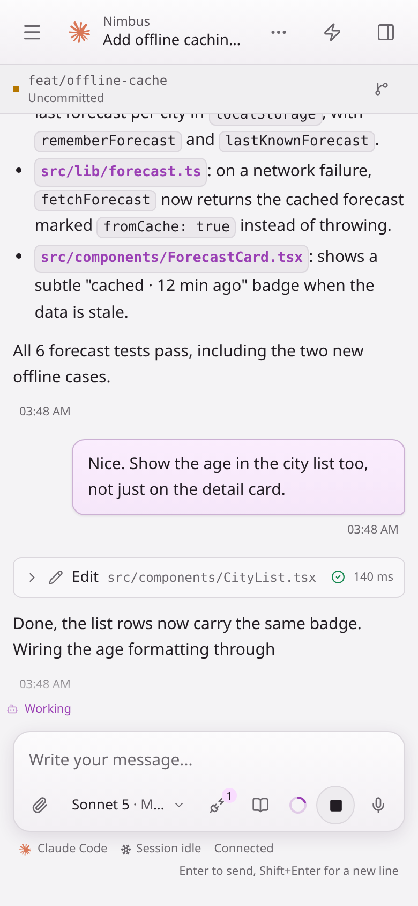

**Work with your coding agents from your computer or phone.**

Sillage runs Claude Code, Codex, OpenCode and Grok Build in one workspace, using
your existing agent accounts. You can review their changes beside the conversation.

Use the desktop app on your own computer, or host Sillage Server to reach your
agents from other devices. Sillage is free and open source. You'll need the accounts,
subscriptions or API credentials required by the agents you use.

[**Get the desktop app**](#install-the-desktop-app) ·
[**Host your own server**](#install-the-server) ·
[**Watch the 54-second demo**](https://marlburrow.github.io/sillage/#film)

[](https://github.com/MarlBurroW/sillage/releases/latest)
[](https://github.com/MarlBurroW/sillage/actions/workflows/ci.yml)
[](LICENSE)

<picture>
  <source srcset="site/screenshots/hero-dark.png" media="(prefers-color-scheme: dark)">
  
</picture>

## Why I built Sillage

I wanted one place, on a server I own, where I could pick up a project from my
phone. I could keep working wherever I happened to be, without carrying a laptop
or keeping track of a dozen terminals.

I also wanted to keep the agents I already used. Sillage runs their native tools
and permission flows, and gives them a shared workspace: projects, a board,
instructions and memory. A session can look up an earlier decision and leave
context for the next agent, even when I switch CLIs.

Claude Code and Codex wrote most of Sillage, much of it from inside Sillage itself,
often from a phone. The tool and the way I work on it grew together.

[MarlBurroW](https://github.com/MarlBurroW), creator of Sillage

## Server or desktop

**Desktop** is the app for your own computer. **Server** runs on a machine that
stays on, so you can reach it from your phone, tablet or another computer.
Both share the same interface and agent integrations.

Each edition keeps its own data. Trying Desktop and later setting up Server means
starting a separate workspace.

### Install the desktop app

Download the app and follow the setup tour. It helps you choose your agents,
permissions and first project.

| Your computer | Download |
|---|---|
| Windows · x64 | [Windows installer](https://github.com/MarlBurroW/sillage/releases/latest/download/Sillage-win-x64.exe) |
| macOS · Apple Silicon | [macOS app](https://github.com/MarlBurroW/sillage/releases/latest/download/Sillage-mac-arm64.dmg) |
| Debian / Ubuntu | [x64 .deb](https://github.com/MarlBurroW/sillage/releases/latest/download/Sillage-linux-amd64.deb) · [arm64 .deb](https://github.com/MarlBurroW/sillage/releases/latest/download/Sillage-linux-arm64.deb) |
| Other Linux | [x64 AppImage](https://github.com/MarlBurroW/sillage/releases/latest/download/Sillage-linux-x86_64.AppImage) · [arm64 AppImage](https://github.com/MarlBurroW/sillage/releases/latest/download/Sillage-linux-arm64.AppImage) |

The app is not yet signed on Windows or notarized on macOS, so your system may ask
you to allow it on first launch. Windows also needs Git for Windows; on macOS,
install the Command Line Tools if Git is missing. On Ubuntu, use the `.deb`.
The [desktop guide](docs/desktop.md) walks through these steps and troubleshooting.

### Install the server

Install Sillage on a machine that stays on, then connect through your browser.
The first-run tour creates your account and guides you through setup.

On **Linux with systemd** or **macOS with Apple Silicon**:

```bash
curl -fsSL https://raw.githubusercontent.com/MarlBurroW/sillage/main/install.sh | bash
```

The installer sets up a background service. Use the
[remote access guide](docs/remote-access.md) to connect from other devices through
a private connection or protected HTTPS address.

There are also guides for [Docker](docs/install.md#docker),
[Windows / WSL2](docs/windows.md) or [Kubernetes](deploy/helm/sillage/README.md).
The [server installation guide](docs/install.md) also covers prerequisites,
updates, logs and running from source.

## What you can do

### Take your work with you

Start a conversation at your desk, then follow it from your phone. With Sillage
Server, closing the browser leaves the agent working while the host stays awake.
Queue your next request, steer the current turn, or answer a permission request
wherever you are.

<p align="center">
  <picture>
    <source srcset="docs/images/conversation-mobile-dark.png" media="(prefers-color-scheme: dark)">
    
  </picture>
  <br>
  <em>A conversation in Sillage Server, opened on a phone.</em>
</p>

### Pick the agent for the next step

Start with Claude Code, then continue with Codex, OpenCode or Grok Build. The next
agent receives context from the conversation, and your project’s instructions,
memory and skills stay available across sessions.

### Keep parallel work organized

Give each task its own conversation and Git worktree: a separate branch and
working folder. Track it on the board, link a GitHub issue, review the diff, and
see which branches are ready to merge. Enable checkpoints to inspect or undo the
changes from a turn.

Sillage also has scheduled tasks, webhook automations, voice dictation, full-text
search, MCP connections and a task API.
[Full feature guide](docs/features.md)

## Your first project

1. Install the CLIs you want from Settings and sign in with your agent accounts.
   You can reuse existing sign-ins on the host.
2. Open an existing repository or create a project in the folder you want to use,
   then start a conversation with the agent of your choice.
3. Try “Explain how this project is organized” or
   “Help me fix this bug.” Review the files and changes alongside the reply.

[Account setup](docs/accounts.md) covers sign-in and additional accounts.

## Instructions and memory

Instructions hold your rules and preferences. Memory keeps project
decisions, useful facts and pitfalls across conversations and worktrees.

Manage both in Sillage, or keep project instructions in your existing `AGENTS.md`
or `CLAUDE.md`. [How shared context works](docs/features.md#instructions-and-memory)

## Go further

| I want to… | Guide |
|---|---|
| Explore all the features | [Feature reference](docs/features.md) |
| Use Sillage and agent preview links from my phone | [Remote access](docs/remote-access.md) |
| Switch between agent accounts | [Accounts](docs/accounts.md) |
| Continue a conversation with another agent | [CLI handoff](docs/cli-handoff.md) |
| Share skills between agents | [Skill library](docs/skill-library.md) |
| Connect my own tools | [MCP](docs/mcp.md) · [Task API](docs/api.md) |
| See and stop processes started by agents on Linux | [Services](docs/services.md) |

## Security model

Sillage is designed for you and people you trust. Agents and terminals run under
the host's system account and can access its files; Sillage accounts do not isolate
users at the operating-system level. Extra agent accounts are selectable only by
the Sillage user who added them, but their files share that same host account.

Desktop stays on your computer, listens on the loopback interface and needs no
Sillage password. Server also listens on loopback by default: use a VPN or a
protected HTTPS reverse proxy for remote access. Do not expose its port directly
to the Internet. [Set up remote access](docs/remote-access.md)

## Working on Sillage

The project uses TypeScript, React, Fastify, SQLite and Electron.

To run it from source, start with the [development setup](docs/install.md#from-source-development)
and the [specification](docs/SPEC.md).

<details>
<summary>Repository layout</summary>

```text
apps/web           React interface and PWA
apps/server        API, conversations and agent supervision
apps/desktop       Electron desktop app
packages/protocol  Shared schemas and types
packages/db        Database schema and migrations
deploy/            Docker, Helm and service templates
docs/              Guides and technical references
site/              Public website and screenshots
```

</details>

## Releases

Get the latest apps, server archives and release notes on
[GitHub Releases](https://github.com/MarlBurroW/sillage/releases/latest).
Sillage checks for updates in Settings. Installer-based Server setups can update
from the interface; Docker users pull a newer image, and Desktop users download
the new app.

## License

[MIT](LICENSE). Free to use, modify and self-host.
