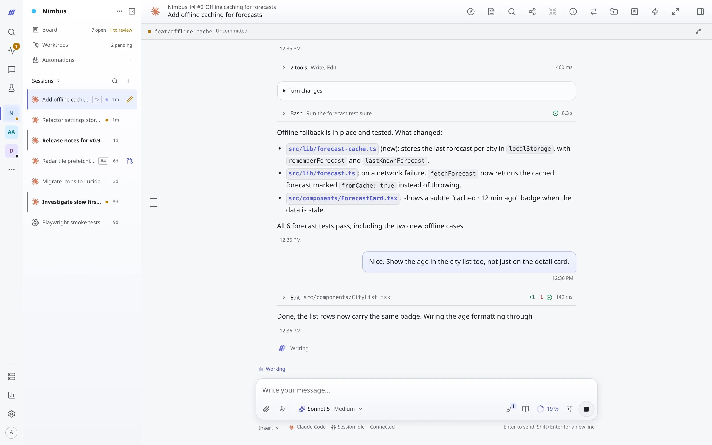
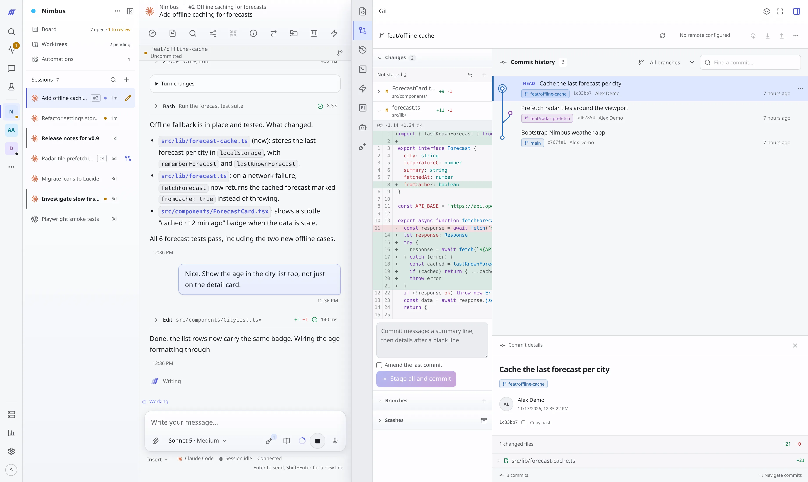
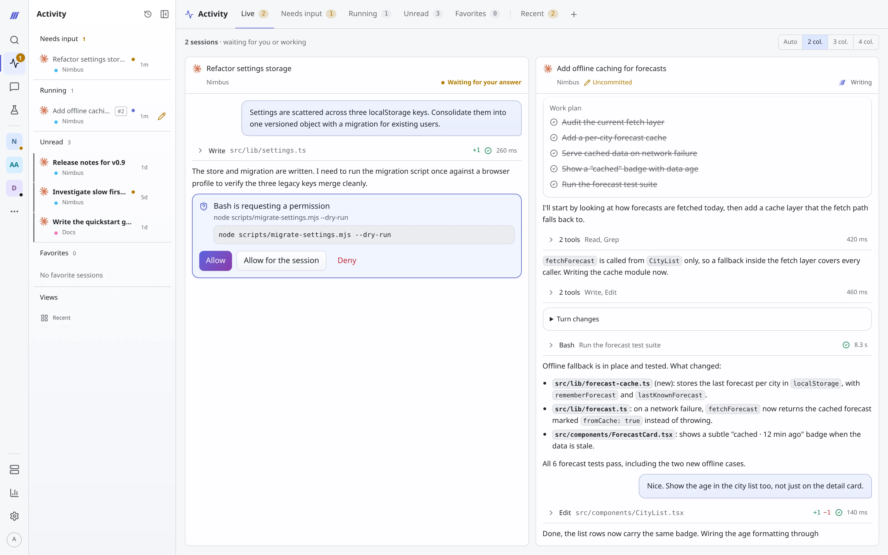
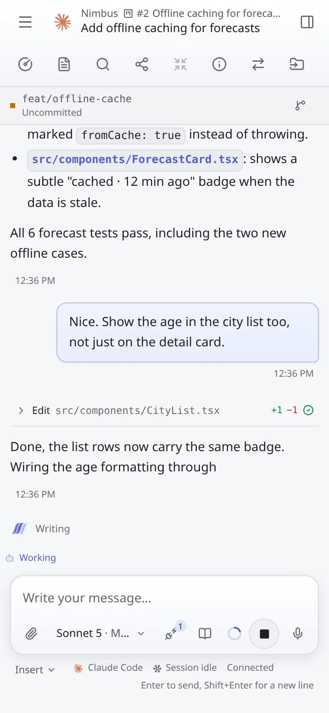
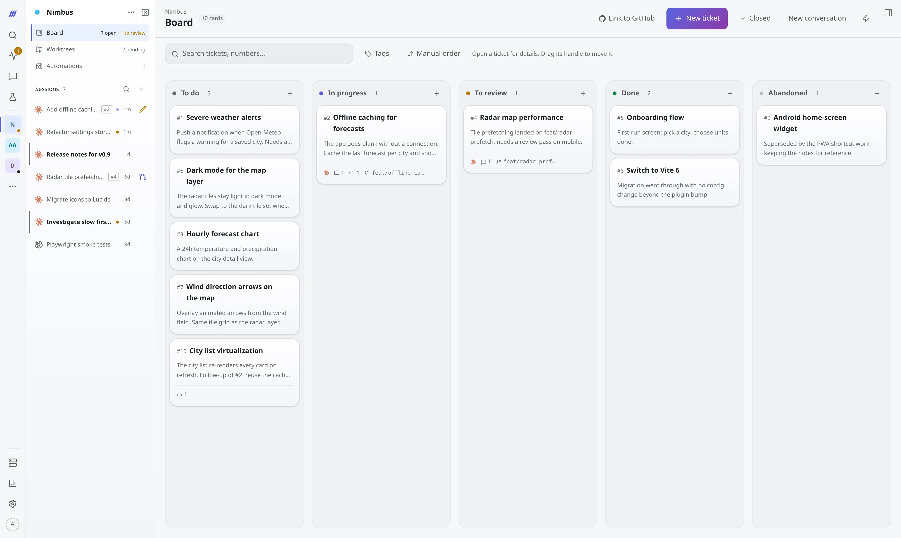
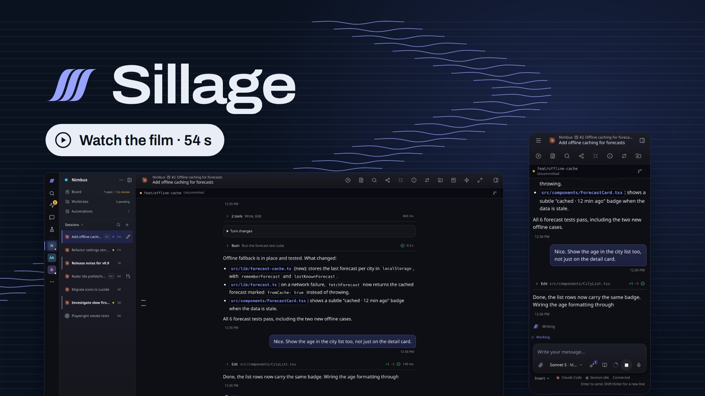

<p align="center">
  <a href="https://marlburrow.github.io/sillage/"></a>
</p>

<h1 align="center">Your coding agents, in one workspace.</h1>

<p align="center">
  Run Claude Code, Codex, OpenCode, Grok Build and Antigravity with your own accounts.<br>
  Review their changes and pick up any session from your computer or your phone.
</p>

<p align="center">
  <a href="https://marlburrow.github.io/sillage/"><b>Website</b></a> ·
  <a href="https://marlburrow.github.io/sillage/features.html">Features</a> ·
  <a href="https://marlburrow.github.io/sillage/agents.html">Agents</a> ·
  <a href="https://marlburrow.github.io/sillage/download.html">Download</a> ·
  <a href="docs/features.md">Documentation</a>
</p>

<p align="center">
  <a href="https://github.com/MarlBurroW/sillage/releases/latest"></a>
  <a href="https://github.com/MarlBurroW/sillage/actions/workflows/ci.yml"></a>
  <a href="LICENSE"></a>
</p>

<picture>
  <source srcset="site/screenshots/hero-2x-dark.webp" media="(prefers-color-scheme: dark)">
  
</picture>

Sillage is free and open source, as a desktop app or on a server you host. There is
no Sillage subscription: you bring the accounts, subscriptions or API keys your
agents need.

<p align="center">
  <a href="#install-the-desktop-app"><b>Get the desktop app</b></a> ·
  <a href="#install-the-server"><b>Host your own server</b></a> ·
  <a href="https://marlburrow.github.io/sillage/#film"><b>Watch the 54-second film</b></a>
</p>

## The agents stay themselves

Sillage doesn't wrap a model behind its own agent. It drives each vendor's CLI, so
plans, permissions, models and limits are the ones you know.

| Agent | From | You sign in with |
|---|---|---|
| **Claude Code** | Anthropic | A Claude subscription or an API key |
| **Codex** | OpenAI | Your ChatGPT account or an API key |
| **OpenCode** | Open source | The providers you configured in OpenCode, local models included when the provider supports them |
| **Grok Build** | xAI | A Grok subscription or an xAI API key |
| **Antigravity** | Google | A Google account or a Gemini API key |

Start a task with one agent and continue it with another. The next agent receives
the conversation's context, and the project's instructions, memory and skills are
there for all of them.

[What each integration supports](https://marlburrow.github.io/sillage/agents.html) ·
[Antigravity's native limitations](docs/antigravity-integration.md)

## What you can do

### Read the diff while the agent is still working

The panel beside the conversation holds the files, the branches and the commit
history. You see what a turn changed without switching to a terminal.

<picture>
  <source srcset="site/screenshots/panel-git-2x-dark.webp" media="(prefers-color-scheme: dark)">
  
</picture>

- Stage, commit and push from the same panel.
- Turn on checkpoints to inspect or undo what a turn changed.
- A file explorer, an editor and terminals sit next to the thread.

### Run several tasks, each in its own worktree

Start a session on a branch Sillage creates for it. Activity lines the sessions up
side by side and brings forward the ones that are waiting for you.

<picture>
  <source srcset="site/screenshots/wall-2x-dark.webp" media="(prefers-color-scheme: dark)">
  
</picture>

- Sessions are grouped by state: needs input, running, unread.
- Each worktree says whether its branch has been merged, and finished ones are
  cleaned up in one confirmation.
- Type `@@` in a message to point an agent at an earlier conversation.

### Answer from your phone

A permission request doesn't have to wait until you are back at your desk. Open the
same conversation on a phone, read what the agent did, then allow, deny or reply.

<p align="center">
  <picture>
    <source srcset="site/screenshots/hero-mobile-2x-dark.webp" media="(prefers-color-scheme: dark)">
    
  </picture>
</p>

- Server keeps sessions running after you close the browser.
- Push notifications tell you when a session needs you, on Server over HTTPS.
- Desktop can be reached privately through Tailscale while the app is open.
- Queue your next request or steer the current turn from wherever you are.

Claude Code and Codex wrote most of Sillage this way: from inside Sillage, often
from a phone.

### Plan on a board the agents can read

Each project has a board. A card keeps the branch and the sessions that work on it,
and agents can open cards, move them and leave notes as the work advances.

<picture>
  <source srcset="site/screenshots/board-2x-dark.webp" media="(prefers-color-scheme: dark)">
  
</picture>

- Link the board to a GitHub repository to work from its issues.
- Tag cards, link related ones, and attach a conversation to its card.

### Leave the routine to a schedule

Run a prompt at an interval, on a cron schedule, or when a webhook fires. A small
check script can decide whether there is anything to do before an agent starts.

- An unattended agent can leave you a question and pick up your answer.
- Work resumes after a subscription limit resets.
- Webhook triggers need Server and a reachable address.

### Give every agent the same context

Instructions hold your rules and preferences. Memory keeps project decisions,
useful facts and pitfalls across conversations and worktrees, whichever agent wrote
them. Skills and MCP servers are installed once and shared too.

Manage them in Sillage, or keep project instructions in your existing `AGENTS.md`
or `CLAUDE.md`. [How shared context works](docs/features.md#instructions-and-memory)

### And the rest

The website lists 56 features, each one written down, with what works in Desktop,
in Server or in both.

| Chapter | What it covers |
|---|---|
| [Conversations](https://marlburrow.github.io/sillage/features.html#conversations) | Queue and steer messages, search, references, dictation, tool display |
| [Code and worktrees](https://marlburrow.github.io/sillage/features.html#code) | Explorer, editor, Git, checkpoints, terminals |
| [Projects and planning](https://marlburrow.github.io/sillage/features.html#projects) | Boards, GitHub issues, linked cards and sessions |
| [Context and tools](https://marlburrow.github.io/sillage/features.html#context) | Shared instructions, memory, skills, MCP servers |
| [Automation](https://marlburrow.github.io/sillage/features.html#automation) | Schedules, webhooks, decisions, an API for tasks |
| [Activity and insights](https://marlburrow.github.io/sillage/features.html#insights) | Activity wall, token consumption, model benchmarks |
| [Export and sharing](https://marlburrow.github.io/sillage/features.html#sharing) | Offline exports, masked secrets, public links |
| [Editions and access](https://marlburrow.github.io/sillage/features.html#editions) | Desktop, Server, remote access, notifications |

The [feature reference](docs/features.md) in this repository has the details.

## Sillage in 54 seconds

From a conversation on a computer to a decision taken on a phone. The film plays on
the website, with sound.

<a href="https://marlburrow.github.io/sillage/#film"></a>

## Server or desktop

**Desktop** is the app for your own computer. **Server** runs on a machine that
stays on, so you can reach it from your phone, tablet or another computer.
Both share the same interface and agent integrations.

Each edition keeps its own data. Trying Desktop and later setting up Server means
starting a separate workspace.
[Compare the two](https://marlburrow.github.io/sillage/download.html#compare)

### Install the desktop app

Download the app and follow the setup tour. It helps you choose your agents,
permissions and first project.

| Your computer | Download |
|---|---|
| Windows · x64 | [Windows installer](https://github.com/MarlBurroW/sillage/releases/latest/download/Sillage-win-x64.exe) |
| macOS · Apple Silicon | [macOS app](https://github.com/MarlBurroW/sillage/releases/latest/download/Sillage-mac-arm64.dmg) |
| Debian / Ubuntu | [x64 .deb](https://github.com/MarlBurroW/sillage/releases/latest/download/Sillage-linux-amd64.deb) · [arm64 .deb](https://github.com/MarlBurroW/sillage/releases/latest/download/Sillage-linux-arm64.deb) |
| Other Linux | [x64 AppImage](https://github.com/MarlBurroW/sillage/releases/latest/download/Sillage-linux-x86_64.AppImage) · [arm64 AppImage](https://github.com/MarlBurroW/sillage/releases/latest/download/Sillage-linux-arm64.AppImage) |

The app is not yet signed on Windows or notarized on macOS, so your system may ask
you to allow it on first launch. Windows also needs Git for Windows; on macOS,
install the Command Line Tools if Git is missing. On Ubuntu, use the `.deb`.
The [desktop guide](docs/desktop.md) walks through these steps and troubleshooting.

The app downloads updates in the background. Install a ready update from Settings >
About, or quit the app to install it automatically (except `.deb`, which asks for
administrator permission). On macOS, keep Sillage in the Applications folder.

### Install the server

Install Sillage on a machine that stays on, then connect through your browser.
The first-run tour creates your account and guides you through setup.

On **Linux with systemd** or **macOS with Apple Silicon**:

```bash
curl -fsSL https://raw.githubusercontent.com/MarlBurroW/sillage/main/install.sh | bash
```

The installer sets up a background service. Use the
[remote access guide](docs/remote-access.md) to connect from other devices through
a private connection or protected HTTPS address.

There are also guides for [Docker](docs/install.md#docker),
[Windows / WSL2](docs/windows.md) or [Kubernetes](deploy/helm/sillage/README.md).
The [server installation guide](docs/install.md) also covers prerequisites,
updates, logs and running from source.

### Your first project

1. Install the CLIs you want from Settings and sign in with your agent accounts.
   You can reuse existing sign-ins on the host.
2. Open an existing repository or create a project in the folder you want to use,
   then start a conversation with the agent of your choice.
3. Try “Explain how this project is organized” or
   “Help me fix this bug.” Review the files and changes alongside the reply.

[Account setup](docs/accounts.md) covers sign-in and additional accounts.

## Why I built Sillage

> I wanted one place, on a server I own, where I could pick up a project from my
> phone, without carrying a laptop or keeping track of a dozen terminals.

I also wanted to keep the agents I already used. Sillage runs their native tools
and permission flows, and gives them a shared workspace: projects, a board,
instructions and memory. A session can look up an earlier decision and leave
context for the next agent, even when I switch CLIs.

The tool and the way I work on it grew together. *Sillage* is French for the wake
a boat leaves on the water.

[MarlBurroW](https://github.com/MarlBurroW), creator of Sillage

## Go further

| I want to… | Guide |
|---|---|
| Explore all the features | [Feature catalog](https://marlburrow.github.io/sillage/features.html) · [Feature reference](docs/features.md) |
| Use Sillage and agent preview links from my phone | [Remote access](docs/remote-access.md) |
| Switch between agent accounts | [Accounts](docs/accounts.md) |
| Continue a conversation with another agent | [CLI handoff](docs/cli-handoff.md) |
| Share skills between agents | [Skill library](docs/skill-library.md) |
| Connect my own tools | [MCP](docs/mcp.md) · [Task API](docs/api.md) |
| See and stop processes started by agents on Linux | [Services](docs/services.md) |
| Report a bug or ask for something | [Issues](https://github.com/MarlBurroW/sillage/issues) |

## Security model

Sillage is designed for you and people you trust. Agents and terminals run under
the host's system account and can access its files; Sillage accounts do not isolate
users at the operating-system level. Extra agent accounts are selectable only by
the Sillage user who added them, but their files share that same host account.

Desktop stays on your computer, listens on the loopback interface and needs no
Sillage password. Server also listens on loopback by default: use a VPN or a
protected HTTPS reverse proxy for remote access. Do not expose its port directly
to the Internet. [Set up remote access](docs/remote-access.md)

## Working on Sillage

The project uses TypeScript, React, Fastify, SQLite and Electron.

To run it from source, start with the [development setup](docs/install.md#from-source-development)
and the [specification](docs/SPEC.md).

<details>
<summary>Repository layout</summary>

```text
apps/web           React interface and PWA
apps/server        API, conversations and agent supervision
apps/desktop       Electron desktop app
packages/protocol  Shared schemas and types
packages/db        Database schema and migrations
deploy/            Docker, Helm and service templates
docs/              Guides and technical references
site/              Public website and screenshots
```

</details>

## Releases

Get the latest apps, server archives and release notes on
[GitHub Releases](https://github.com/MarlBurroW/sillage/releases/latest).
Settings > CLI versions shows installed and recommended agent versions. You can
install or update managed CLIs there; Sillage waits for active sessions before
replacing a binary and refreshes the available models afterward.

Sillage checks for updates in Settings. Installer-based Server setups can update
from the interface; Docker users pull a newer image, and Desktop downloads updates
in the background and lets you install them from About.

## License

[MIT](LICENSE). Free to use, modify and self-host. Sillage is independent and not
affiliated with the agent providers.
