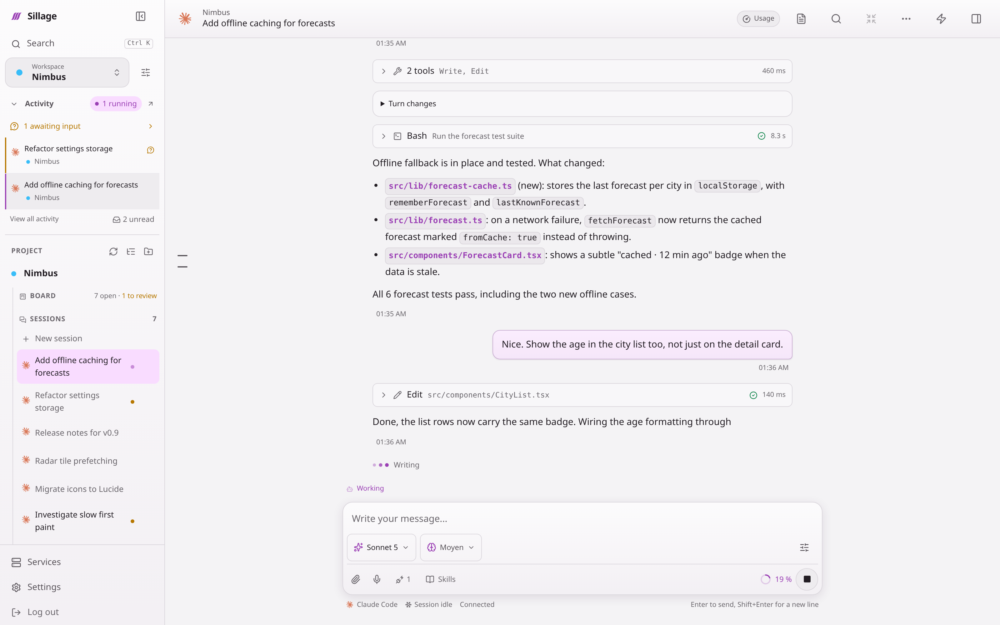

[](https://github.com/MarlBurroW/sillage/releases/latest)
[](https://github.com/MarlBurroW/sillage/actions/workflows/ci.yml)
[](LICENSE)

A self-hosted, mobile-first web UI that drives the native Claude Code, Codex, OpenCode
and Grok Build CLIs on your own machine. Vibe-code from anywhere: the official agent harnesses,
without the terminal.

It comes in two editions, from the same code and the same releases
([compare them](#server-or-desktop)):

- **Sillage Server** runs permanently on a server, or on any machine that stays on,
  and you reach it from any device: phone, tablet or laptop. Linux, macOS (Apple
  Silicon), Windows through WSL2, Docker or Kubernetes.
  [Set up private remote access and agent preview links](docs/remote-access.md).
- **Sillage Desktop** is an app for your workstation, macOS (Apple Silicon), Windows or
  Linux, with nothing to host: it opens Sillage in its own window, on that computer only.

Website: [marlburrow.github.io/sillage](https://marlburrow.github.io/sillage) ·
Film: [Sillage in 54 seconds ▶](https://marlburrow.github.io/sillage/#film)

<picture>
  <source srcset="site/screenshots/hero-dark.png" media="(prefers-color-scheme: dark)">
  
</picture>

## Why

Coding agents work best inside the harness their vendor ships: its prompts, its
tools, its permission flow. Rewriting that inside a web app gets you a worse agent
behind a nicer interface. So Sillage drives the native CLIs and replaces the one
part that does not travel, the terminal.

Sillage is built with AI, heavily. Claude Code and Codex wrote most of the code,
and most of that happened from inside Sillage itself.

The full specification lives in [docs/SPEC.md](docs/SPEC.md) (French).

## What it adds on top of the CLIs

- **Sessions that outlive the client.** The event journal on the server is the
  source of truth, not the browser: close the browser mid-turn and reopen on a
  phone through your configured remote connection. While the host stays awake and
  Sillage is running, the agent keeps working and the thread replays as it happened.
- **A queue, and steering.** Write while a turn runs. The message waits on the
  server and can be withdrawn, or goes straight into the turn already in flight.
- **One grammar for every CLI.** Claude Code, Codex, OpenCode and Grok Build are translated
  into a single event schema, so history, search, the board and the panel behave the
  same way whichever one ran the conversation.
- **The repository, one panel away.** File explorer, editor, diffs, a branch graph
  and terminals, beside the conversation that changed them. Stage changes, commit,
  manage branches and remotes, or copy and move several files at once. The commit
  history draws its branches and merges as a graph, over the current branch or all
  of them, with a diff inspector for each commit. Images that agents read or
  produce open in a viewer with zoom, rotation, copy and download.
- **What each turn changed, and a way back.** With turn checkpoints enabled on a
  project, Sillage captures the workspace before and after every turn in hidden git
  refs. Each turn lists the files it changed, opens them as a diff, and can be
  reverted: the files go back to their state before the turn, commits made during
  it stay as uncommitted changes, and you can fork the conversation from before
  that turn at the same time.
- **Project actions.** Save a test command, a dev server or a debug script as a
  button, available from the project header, the workspace panel and the command
  palette. Tasks keep their output and exit code; services run as persistent user
  units on Linux with systemd, with a terminal fallback elsewhere. Agents can
  propose actions for you to review before their first launch from the interface.
  Definitions stay in Sillage, without adding files to your repository.
- **Worktrees, followed to the end.** Start a conversation on the project root, on
  an existing worktree, or on a branch Sillage creates for it. The project page lists
  every tree git knows, including those created from a shell, compared with the
  default branch: uncommitted work, commits to merge, merged, or folder missing, with
  the sessions working there. The sidebar shows each conversation's branch and state.
  Cleaning up a tree is one action that first says what would be lost; once a tree
  is merged and clean, Sillage proposes the cleanup as a decision. Agents create and
  list worktrees through `create_worktree` and `list_worktrees`, so the interface
  sees them.
- **Full-text search** across every conversation in every project.
- **Processes launched by Sillage.** On Linux, see what each agent and terminal has
  started, each command with its process tree, ports and originating conversation,
  plus the permanent apps agents run as `sillage-app-*` systemd units; stop them from
  the same page. Other systemd services and tmux sessions are excluded.
  [Detection and limits](docs/services.md).
- **A board connected to GitHub.** Keep local cards alongside issues from a linked
  repository, with descriptions, comments, attachments and sessions. Choose whether
  new cards stay local or become issues; labels and issue state map to board columns.
  Agents can read cards, leave notes, create cards, and close or reopen linked issues
  through the built-in MCP server. Optional maintenance starts a session for a new
  issue and brings subsequent comments into that issue's session, using your
  instructions, CLI and worktree choice.
- **Sessions that coordinate.** Through the same server, a session can message
  another, ask to be notified when it finishes, or start a new one when you ask:
  "start a Codex session at max effort to fix this" opens a conversation that you
  can follow like any other, with its own CLI, model, effort and worktree. The new
  session starts with the project's default permissions.
- **Scheduled tasks.** A prompt replayed on a schedule, by interval, cron
  expression or at a single date, each run in a fresh session of the CLI you chose,
  with the model, effort and permissions fixed on the task. The daemon fires it with
  nobody at the keyboard: the agent is told so, gets the date, link and last reply of
  the previous run, and is cut off after a maximum duration. Runs stay out of the
  session list and sit under their task in the sidebar. An optional check script
  runs first, in any language: exit 0 wakes the agent with the script's output,
  exit 10 skips the run without opening a session, so a daily watch only costs
  tokens when something changed. Agents can schedule too, through `schedule_task`,
  the durable equivalent of Claude's session-bound cron; a check script an agent
  writes waits for your approval before it runs.
- **Webhook automations.** Start a session when an issue gets a label, a pull
  request opens, CI fails, or another service sends an event. Inspect payloads,
  build conditions and prompts from their fields, and simulate a delivery without
  starting an agent. GitHub templates, an optional sandboxed JavaScript filter,
  delivery deduplication and hourly limits help keep triggers under control.
- **Decisions for autonomous work.** Enable decision requests on a schedule,
  webhook automation or GitHub maintenance rule. The agent can leave a question in
  **Decisions** and receive your answer back in its session, with an expiry and an
  optional fallback choice. This is separate from the CLI's permission requests
  and is off by default for each source.
- **Shared instructions and memory.** One `SILLAGE.md` and one project memory for
  all four CLIs, editable from the interface, which agents can read and rewrite.
  [How it works](#instructions-and-memory).
- **Installable PWA with notifications.** In-app toasts for questions and decisions,
  push notifications on other devices, and silence while you already have the
  conversation open. Manage subscribed devices and send a test from Settings.
- **Dictation** biased with a lexicon read from the project itself plus the
  current branch, then an optional cleanup pass. Any OpenAI-format endpoint.
- **Continue a conversation in another CLI.** From Claude Code to Codex, OpenCode or
  Grok Build and back: the new agent receives a budgeted selection of the thread, full messages rather
  than a summary, with references it can read back through the Sillage MCP server.
  [How the handoff is built](docs/cli-handoff.md).
- **MCP servers** declared once and handed to the agents that should get them.
- **A shared skill library** for Claude Code, Codex, OpenCode and Grok Build, with global and
  project skills managed from the interface. [Skill library](docs/skill-library.md).
- **Extra accounts.** Register other Claude subscriptions or API keys, other Codex
  subscriptions or API keys, and other Grok subscriptions or xAI API keys from the
  interface, then pick one when creating
  a conversation or from its composer. Compare subscription usage before choosing;
  extra Claude subscriptions need a separate guided sign-in to enable their gauge.
  Added accounts belong to the Sillage user who registered them.
  [Extra accounts](docs/accounts.md).
- **A composer you can arrange.** Model and effort sit in one chip under the
  message box; pin the other settings you use next to it: permissions, speed,
  account, advisor or other controls supported by that CLI, and order them. Each
  CLI keeps its own layout; on a phone the chip stays and the rest lives in the
  settings panel.
- **A task API for machines.** `/api/v1` speaks tasks rather than screens: open
  one in a project, follow its events, answer what it asks, steer or interrupt
  it, and take a webhook when it lands. Bearer tokens carry their own scopes and
  an optional list of allowed projects, separate from the browser session.
  Create projects with `POST /api/v1/projects` and the explicit `projects:write`
  scope on an unrestricted token. [Project creation API](docs/api.md).
- **Sillage's MCP from your own tools.** Connect an external CLI to project history,
  boards, instructions and memory, and launch work across projects. Use stdio on
  the host or over SSH, or Streamable HTTP at `/api/v1/mcp` with an API token carrying
  the `mcp` scope and optional project restrictions. Session-to-session messaging
  stays inside Sillage. [MCP setup and scope](docs/mcp.md).

The CLI versions this tree targets are kept in
[`packages/protocol/src/cli-versions.ts`](packages/protocol/src/cli-versions.ts).
Sillage can install them from Settings and flags incompatible installed versions.

## Instructions and memory

Each CLI keeps its own context files: Claude Code reads `CLAUDE.md` and its auto
memory under `~/.claude`, Codex reads `AGENTS.md`, OpenCode and Grok Build read
`AGENTS.md` or `CLAUDE.md`. Sillage gives all four the same two things instead.

|  | Instructions (`SILLAGE.md`) | Memory |
| --- | --- | --- |
| What it holds | Rules you set: conventions, preferences, things to avoid | What agents learned while working: decisions, pitfalls, facts |
| Scope | One global part, one part per project | One per project, shared by all its worktrees |
| Who writes | You, in the interface; agents when you ask them | Agents, on their own; you can fix or delete notes |
| Claude Code | Appended to its system prompt | Its native auto memory, pointed at Sillage's folder (`autoMemoryDirectory`) |
| Codex | Added to its developer instructions | The index is given at startup; it reads notes from the folder and writes through MCP tools |
| OpenCode | Sent as the system prompt of each message | The index comes with each message; it reads notes from the folder and writes through MCP tools |
| Grok Build | Appended to its system prompt when the session is created (`rules`) | The index is given at creation; it reads notes from the folder and writes through MCP tools |
| Agent tools | `read_instructions` · `edit_instructions` · `write_instructions` | `read_memory` · `write_memory` · `delete_memory` |
| Edited from | Settings › Instructions (global), the project page, the conversation header | The project page |

**Where a project's instructions live** is chosen when the project is created, and
can be changed later:

- *In Sillage*: kept in Sillage and given to every CLI. The repository's `CLAUDE.md`
  and `AGENTS.md` are hidden from agents (`claudeMdExcludes` for Claude Code,
  `project_doc_max_bytes = 0` for Codex, `OPENCODE_DISABLE_PROJECT_CONFIG` for
  OpenCode, an agent profile without `agentsMd` for Grok Build) so nothing arrives twice. The files themselves are not touched.
  OpenCode has no finer switch: its project `opencode.json` and `.opencode/` folder
  are skipped too.
- *In the repository*: the project part is the workspace's `AGENTS.md` (or
  `CLAUDE.md`), which the CLIs read on their own; the interface edits that file.
  Only the global part comes from Sillage.

By default, a project whose folder already has one of those files stays on the
repository; existing projects keep working as before. Their instructions panel offers
to move the files' content into Sillage in one step.

**Memory** is the format Claude Code already uses: a `MEMORY.md` index and one note per
file, under `<data>/memory/projects/<id>`. On first launch, the memory Claude kept for
the project root is copied there; the original stays in place.

**When changes apply.** Claude Code and Codex read both when a session starts. A
session already running keeps what it received: Claude Code records its system
prompt on the first turn and replays it on resume, until the next compaction.
OpenCode receives them with every message, so an edit reaches it on the next one.
Grok Build receives them when a session is created, and keeps them for its whole life.

Details and the probes behind them: [docs/sillage-md.md](docs/sillage-md.md).

## Server or desktop

Both editions run the same server and the same interface, built from the same release.
What differs is where Sillage runs, and where you reach it from.

| | Sillage Server | Sillage Desktop |
|---|---|---|
| Runs on | a server, a NAS, a VPS, or any machine that stays on | your workstation, as an app |
| Reach it from | any browser: phone, tablet, laptop (installable as a PWA) | its own window, on that computer |
| Agents work | around the clock, with your laptop closed | while the app is open and the computer awake |
| Sign-in | accounts with passwords, for a few trusted people | none: one person, one computer |
| Push notifications | to your phone and other devices | none, in-app toasts only |
| Webhook automations | yes, from GitHub, CI or any service | no: no address the Internet can reach |
| Install | Docker, a service on Linux, macOS or WSL2, Helm | the `.dmg`, `.exe`, `.deb` or AppImage of a release |
| Updates | from the UI, or by pulling a new image | download the new version |

Pick the server to follow your agents from anywhere and leave them working; pick the
desktop app to try Sillage, or to work on the machine where your code lives. Each
keeps its own data: moving from one to the other means a fresh install.

In both, install the CLIs you use from Settings. Reuse their existing sign-ins on the
host, or add Claude and Codex accounts through Sillage's guided sign-in flows.
[Account setup](docs/accounts.md).

## Install the server

### Docker

The agent CLIs are not in the image: install the ones you use from the UI and
they land in the data volume. Mount your credential directories to reuse the
authentication done on the host, and your projects:

```bash
curl -fsSLO https://raw.githubusercontent.com/MarlBurroW/sillage/main/deploy/docker-compose.example.yml
mv docker-compose.example.yml docker-compose.yml   # then adjust the mounted paths
docker compose up -d
```

Then open Sillage in your browser: with no account yet, it starts on the first-run
tour, which creates the first account (admin) and walks you through agents,
permissions, where instructions and memory live, your general instructions and
remote access, then leads to your first project. Without a browser at hand,
the command line does the same:

```bash
docker compose exec -it sillage node /app/server/cli/user-create.js   # first account, admin
```

Update by pulling a newer image tag. The UI tells you when a release is available
and what changed.

### Kubernetes (Helm)

A chart lives in [`deploy/helm/sillage`](deploy/helm/sillage), built on the same
image and the same volumes as the Compose setup.

```bash
helm install sillage ./deploy/helm/sillage \
  --namespace sillage --create-namespace \
  --set storage.data.storageClass=<a-block-storage-class> \
  --set ingress.enabled=true --set ingress.host=sillage.example.com
```

Open the ingress host: the first-run tour creates the first account. Or from a
terminal:

```bash
kubectl -n sillage exec -it deploy/sillage -- node /app/server/cli/user-create.js
```

Sillage runs as a single replica with a `Recreate` strategy: the state is a SQLite
database in WAL mode on a `ReadWriteOnce` volume, and two pods writing to it means
corruption. Give the data volume a block storage class rather than NFS, whose file
locks SQLite cannot rely on. Leaving the class empty is not neutral either: when a
cluster has several default StorageClasses, Kubernetes picks the most recent one
without a word.

The [chart README](deploy/helm/sillage/README.md) covers the rest: ingress and
WebSocket timeouts, egress the pod needs, and what to back up.

### One-line script (Linux, no Docker)

Requires Linux x64/arm64 with systemd. The agent CLIs are optional here too:
Sillage installs the ones you want from the UI, you authenticate them yourself.

```bash
curl -fsSL https://raw.githubusercontent.com/MarlBurroW/sillage/main/install.sh | bash
```

This installs under `~/.local/share/sillage`, sets up a systemd user service and
enables lingering (so the service survives logout). It then checks that the server
actually answers before reporting success. Open Sillage in your browser: the
first-run tour creates the first account and sets the instance up. Later
updates happen from the web UI (Settings > About) or by re-running the script.

Logs go to the journal: `journalctl --user -u sillage -f`.

The service, agents and the dev servers they start included, may use up to 75% of
the RAM before systemd slows it down. To change that, run `systemctl --user edit
sillage` and set `MemoryHigh=` under `[Service]`: the override survives reinstalls.

The service uses the system's Node when it is 22.14 or newer. Otherwise the
installer downloads the current Node LTS under `~/.local/share/sillage/node`, for
Sillage alone, and refreshes it on each run. Any Node from 22.14 up works: every
native module ships as an N-API prebuild, which does not depend on the Node ABI, and
22.14 brings N-API 10, which better-sqlite3 needs.
The installer checks they load and rebuilds them if they do not, which then needs
a compiler (`build-essential` and `python3` on Debian/Ubuntu).

### macOS (Apple Silicon)

The same script installs Sillage Server on Macs with Apple Silicon, as a background
service your other devices can reach. For an app in its own window, see
[the desktop app](#install-the-desktop-app). Run it from Terminal:

```bash
curl -fsSL https://raw.githubusercontent.com/MarlBurroW/sillage/main/install.sh | bash
```

It needs git: if the Command Line Tools are missing, run `xcode-select --install`
first. As on Linux it installs under `~/.local/share/sillage`, fetches Node if the
system has none recent enough, then opens `http://localhost:7317` on the first-run
tour, which creates the first account. The service is a launchd agent: it starts with your session
and keeps running with Terminal closed, but nothing runs while the Mac sleeps.

- Logs: `tail -f ~/.local/share/sillage/logs/sillage.log`. The file is not rotated.
- Stop: `launchctl bootout gui/$(id -u)/io.github.marlburrow.sillage`. Re-running
  the script starts it again.
- Uninstall: stop it, then delete
  `~/Library/LaunchAgents/io.github.marlburrow.sillage.plist` and
  `~/.local/share/sillage`, which holds the database.

The process view (Services) is Linux only.

### Windows (WSL2)

Sillage runs inside WSL2, the Linux built into Windows 10 and 11, and you use it
from your Windows browser. Nothing to install beforehand but WSL itself, not even
Node.

1. In PowerShell, as administrator, install WSL and Ubuntu, then restart Windows
   when asked. Ubuntu opens and asks for a Linux user name and password:

   ```powershell
   wsl --install
   ```

2. In the Ubuntu terminal, run the same installer as on Linux:

   ```bash
   curl -fsSL https://raw.githubusercontent.com/MarlBurroW/sillage/main/install.sh | bash
   ```

   Under WSL it also enables systemd when the distribution lacks it, asks whether
   Sillage should start with Windows, and adds a **Sillage** entry to the Start
   menu. That entry keeps WSL running once the terminal is closed, starts
   Sillage if WSL was stopped, and opens `http://localhost:7317` in the Windows
   browser.

3. Install and sign in to the agents inside Ubuntu: Sillage drives the Linux
   `claude`, `codex`, `opencode` and `grok`, not the Windows ones.

   ```bash
   curl -fsSL https://claude.ai/install.sh | bash && claude
   ```

Keep your projects in the Linux file system (`~/projects`), not under `/mnt/c`:
Windows drives are several times slower for git and the agents. The
[WSL2 guide](docs/windows.md) covers Codex sign-in, how Sillage stays up, everyday
commands, troubleshooting and uninstalling. Tested on Windows 11 with WSL 3.0.1,
Ubuntu 26.04 and 24.04.

### From source (development)

Requires Node 22.14+ and pnpm 9, plus at least one agent CLI, from the host or
installed from the UI:

```bash
pnpm install
pnpm db:generate          # only after changing packages/db/src/schema.ts
pnpm dev                  # API on :7317, Vite UI on :5317 with /api proxy
pnpm user:create          # optional: the first account from a terminal rather than the tour
```

## Install the desktop app

Download the app from the [latest release](https://github.com/MarlBurroW/sillage/releases/latest):
the `.dmg` for Apple Silicon Macs, the `.exe` installer for Windows (x64), the `.deb`
for Debian and Ubuntu (x64, arm64), or the AppImage for other distributions. It bundles the server of the release and its own
Node, and opens Sillage in its own window. Your agents use your own CLIs and sign-ins.

The app is not notarized by Apple yet: on the first launch, allow it in System
Settings > Privacy & Security (**Open Anyway**), or run
`xattr -dr com.apple.quarantine /Applications/Sillage.app`. On Ubuntu 24.04 and
later, prefer the `.deb`: it installs the AppArmor profile the app needs to start. On
Windows, SmartScreen asks you to confirm the first run (**More info**, then **Run
anyway**), and Sillage needs [Git for Windows](https://git-scm.com/download/win).

The [desktop guide](docs/desktop.md) covers what differs from the server, where the
data lives, and how to uninstall.

## Security model

Sillage is built for a trusted circle, not for public exposure:

- Agents run under your system account. The host CLI sign-ins are shared; extra
  Claude and Codex accounts can only be selected by the Sillage user who added them.
  That selection rule is not an operating-system security boundary: agents and
  terminals still run as the same system user and can access its files.
- Terminal mode gives a full shell under that same account.
- There is no system-level isolation between users: a shared project is readable
  by every account.

Sillage Desktop has no password: it opens its own session at launch, and its server,
on `127.0.0.1`, serves only the app's window. Pages opened in a browser or served by
another program on the machine cannot use that session.

The server listens on `127.0.0.1` by default and does not terminate TLS. To reach
it remotely, go through a reverse proxy (Caddy) or a tunnel (Tailscale, Cloudflare
Tunnel with Access). Never expose it directly to the Internet.
The [remote access guide](docs/remote-access.md) walks through Tailscale, other VPN
options, HTTPS, and shared instructions for reachable agent preview links.

## Releases

Releases are git tags (`vX.Y.Z`). Each tag builds Linux tarballs (x64 and arm64) and
a macOS one (Apple Silicon), prebuilt native modules included, a multi-arch Docker
image on `ghcr.io/marlburrow/sillage`, the desktop app (`.dmg` and `.zip` for macOS, an
`.exe` installer for Windows, `.deb` and AppImage for Linux x64 and arm64), and a GitHub
release. The app shows the
installed version, checks for newer releases, and on installer-based setups can
update itself from the UI.

## Repository layout

```
apps/server        Fastify daemon: API, WebSocket, CLI supervision
apps/web           React UI, PWA
apps/desktop       Electron app: runs the release server with its own Node, in a window
packages/protocol  shared event schema and types
packages/db        Drizzle schema and migrations
packages/*-bindings  types generated from the Codex and OpenCode protocols
deploy/            service templates (systemd, launchd), config example, docker-compose example, Helm chart
site/              one-page website (GitHub Pages) and its screenshots
scripts/           screenshot runner, runtime and desktop staging, Codex and OpenCode type generation
docs/desktop.md    the desktop app: download, what differs from a server, uninstall
docs/windows.md    running Sillage on Windows through WSL2
docs/remote-access.md  reaching Sillage and agent preview links from other devices
docs/accounts.md   extra Claude, Codex and Grok accounts, how they are wired, their limits
docs/api.md        the task API and project creation
docs/mcp.md        connecting an external MCP client to Sillage
docs/cli-handoff.md  how a conversation continues in another CLI
docs/skill-library.md  the shared skill library
docs/services.md   what the process view detects, and its limits
docs/sillage-md.md shared instructions and memory, with the probes behind them
docs/CODEX.md      what the Codex adapter relies on, as probed
docs/OPENCODE.md   what the OpenCode adapter relies on, as probed
docs/GROK.md       what the Grok Build adapter (Agent Client Protocol) relies on, as probed
docs/brand/        the brand and the files derived from it
```

## License

MIT, see [LICENSE](LICENSE).
