# Improvements from the UI audit

## First pass: conversation and mobile

Changes address priority corrections, the mobile board, and conversation.

- Title and description drafts are kept per card/account in the tab, including
  after reload and save failures. Slow responses do not erase newer input;
  reopened cards wait for their current save before starting another.
- Card descriptions fit their content up to a maximum height, bringing session
  notes into view.
- Closed navigation is inert. On mobile, Escape closes the drawer, Tab stays
  inside, and focus returns to its opener.
- Secondary text has stronger contrast. Default values measured on the four base
  surfaces range from 4.73:1 to 5.47:1 in light mode and 5.38:1 to 6.93:1 in dark
  mode. Extreme custom settings are outside these measurements.
- The board uses full phone width. Tabs and common touch controls provide more room.
- Conversations, drafts, and board have a single mobile header. Conversations show
  their project; details and account usage are accessible in the menu.
- Message settings have a visible label on narrow screens and a permanent chevron.
  Less restrictive permissions remain indicated.
- The work panel sits beside the conversation with at least 960 px actually
  available after the sidebar. It can enlarge and return to split layout without
  remounting content. Both widths and the enlargement preference are remembered.
  On small screens the panel occupies the view.

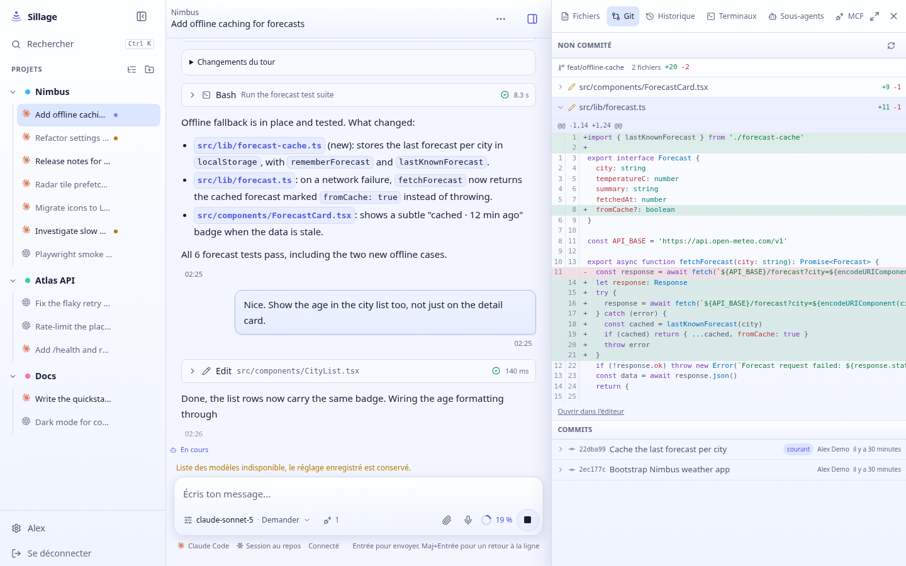

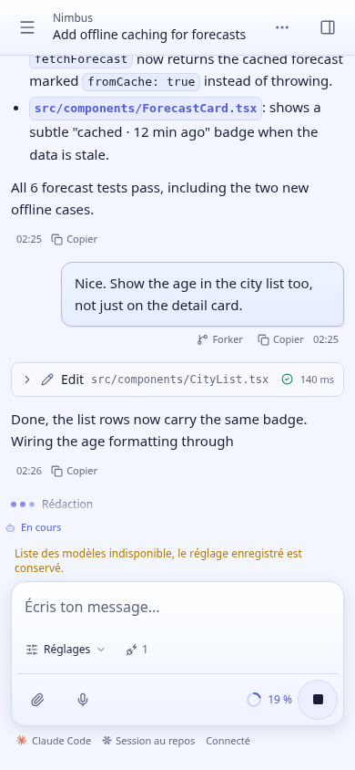

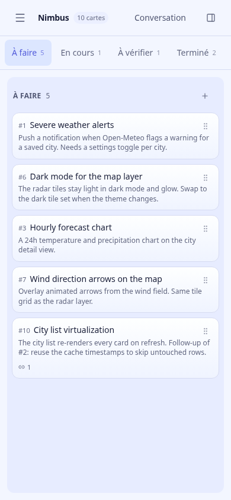

Validation: frontend typecheck/lint, production build, `pnpm test:codex-ui`, and
new `pnpm test:ui`. The latter creates its own temporary instance, disables CLIs,
checks drafts/interactions, then deletes its data. Paths were also inspected in
light/dark mode, and the compiled version opened through the Tailscale name.
No physical Safari/iPhone validation.

The demo uses temporary user service `sillage-ui-preview`, port 7519, and separate
data in `/tmp/sillage-ui-audit/data`. Its frontend is a build copy in
`/tmp/sillage-ui-audit/web`. It does not replace the main instance. To remove it,
stop that user unit and disable Tailscale exposure on port 7519.

## Second pass: navigation, startup, and settings

- The sidebar offers “Needs input”, “In progress”, and “Unread” with counters and
  WebSocket-updated lists. Results show a two-line title and project. Archived
  conversations are excluded. “Needs input” means `awaiting_input`: the agent
  needs a response or approval to continue. Nonblocking Codex questions do not
  mean a blocked agent. Background work counts as “In progress”; merely scheduled
  loops do not.
- Every expanded project shows board and new-conversation access. Thread titles
  use two lines. The menu gathers actions; stars remain visible on existing
  favorites. Shared conversations retain the menu for managing one's own favorite
  without offering owner-only actions.
- Home resumes the last thread, draft, or board viewed, including an open card.
  Memory is browser-local and separated by account. Context existence and access
  are checked before resuming; otherwise home offers the most recent active
  thread, then a new thread if needed. Remembering does not wait for the
  conversation list to load, preserving brief visits too.
- Startup groups agent choice, directory, and a taller input area. Agent choices
  use native radio buttons supporting keyboard arrows. Changing agent preserves
  input. Quotas stay visible in summary, including near-limit ones; details and
  importable sessions expand on demand. Version warnings concern the selected agent.
- An already started card offers “Resume session”, opening its most recent
  nonarchived session by creation date. “New session” remains alongside it.
  Cards without active sessions retain their launch action.
- Settings group into “Personal”, “Agents and projects”, and “Administration”.
  Admin-only sections remain hidden from other accounts. Sliders show readable
  units (`15 px`, `1.65 ×`, percentages), also announced to screen readers.
  Appearance descriptions use simple wording and are no longer truncated.

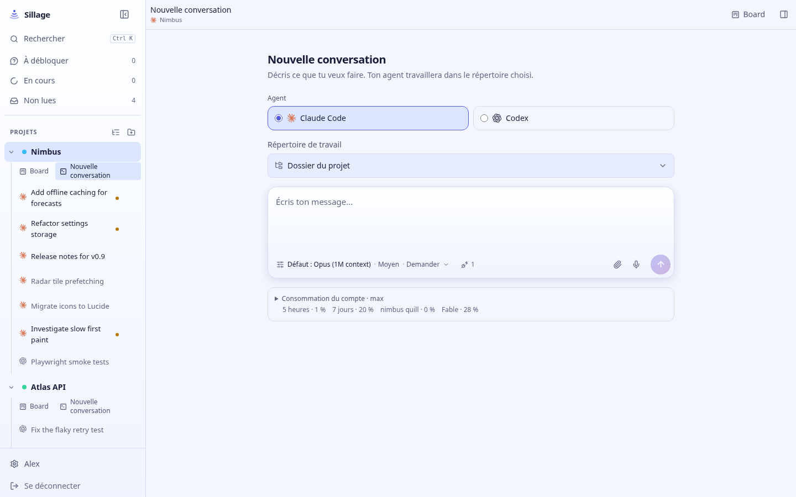

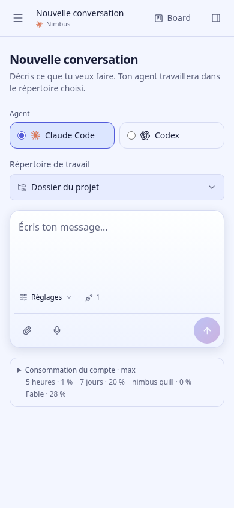

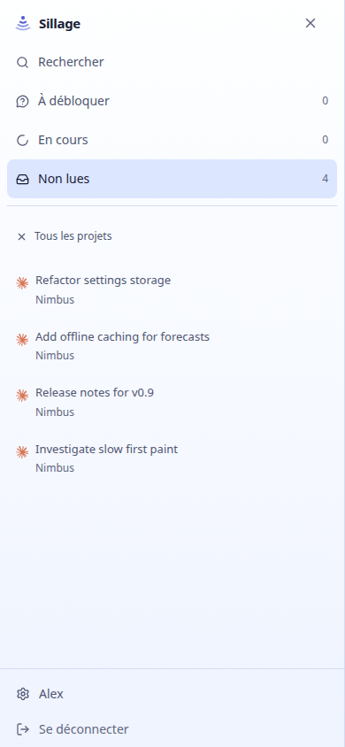

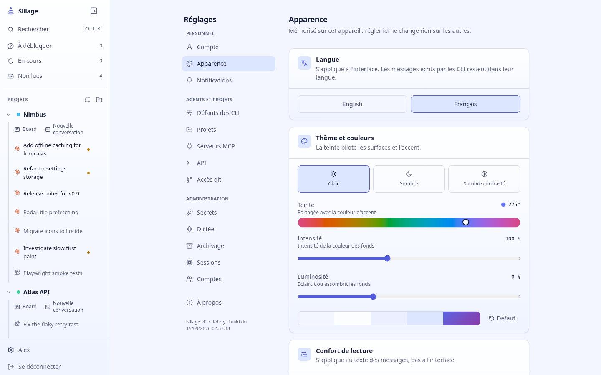

Additional validation: `pnpm test:ui` covers socket-pushed status transitions,
background work, opening an unread thread, resuming threads/cards, deleted context,
and a second account. The form uses simulated agent probes and intercepted sending:
keyboard navigation, preserved drafts, 95% quota visible while collapsed, send
errors, and accessible buttons from 320 to 1440 px. The test server keeps CLIs
disabled and starts no agent task. Card resumption, settings groups, and persistence
of displayed units are also checked.

Typecheck, lint, production build, and `pnpm test:codex-ui` pass. Existing
`::highlight`, CodeMirror import, and bundle-size warnings remain. The compiled
frontend was checked through Tailscale in light/dark mode, desktop and mobile
emulation. Safari and a physical iPhone's virtual keyboard remain unchecked.

The isolated preview now uses the development account's PATH to find installed
CLIs. Its database remains separate. These changes are not deployed to the main instance.

## Third pass: card reading, notes, and moods

- Cards open in reading mode: title, Markdown description, then “Edit card”. The
  form appears on demand or when a draft exists. Save returns to reading; cancel
  clears the draft. Slow-response protections remain.
- The current column becomes a header menu. Status stays visible and all five
  destinations remain accessible without taking a whole section. Resume actions
  and latest note therefore move upward on phones.
- The latest note appears before expandable history. Draft notes are kept per
  card/account in the tab, including after reload. Publication failure preserves
  input and shows an error. Slow publication does not discard a newly started
  note; reopening during publication cannot submit it twice. Loading and deletion
  errors also have visible feedback.
- Card and workspace panels contain focus when occupying the mobile screen.
  Escape closes them and focus returns to the opener, falling back to navigation
  if the card left the visible column. Overlay menus retain their own Escape
  handling; file search, editor, and terminal retain shortcuts. Mobile/desktop
  transitions keep the same editor element mounted. Focus management uses
  FocusScope, already present through Radix and now a direct dependency.
- “Sillage”, “Discreet”, and “Neutral” moods offer three background color strengths.
  They preserve accent color, brightness, and reading settings. Fine settings
  remain in a collapsed section. High-contrast dark retains only its useful
  brightness setting. No preset is automatically applied to existing preferences.

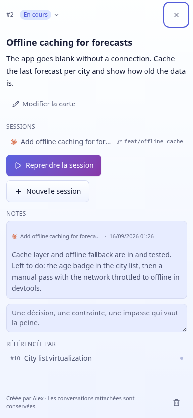

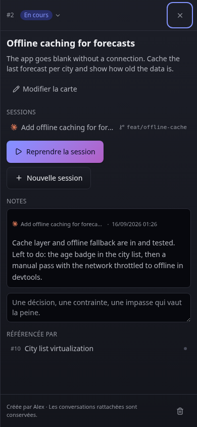

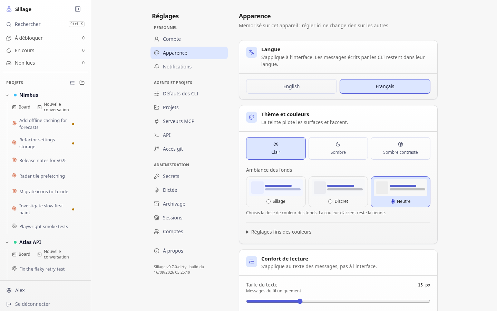

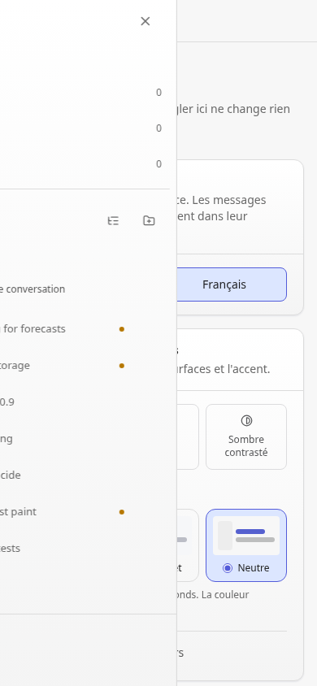

Validation: `pnpm test:ui` covers reading/editing, note drafts after close/reload,
failed publication and recovery, new input during slow publication, note order,
and history. It also checks panel keyboard navigation, column menu, focus return
when a card changes columns, search/editor shortcuts, CodeMirror element identity
after resize, mood persistence, and preservation of custom settings.

Typecheck, build-integrated lint, production build, and `pnpm test:codex-ui` pass.
The compiled frontend was copied to the isolated preview and checked through
Tailscale: HTTP 200, index identical to build, light/dark screenshots, no JavaScript
exceptions on these paths. Settings have no horizontal overflow from 320 to
1440 px. An additional check opens both panels then switches to mobile: Tab stays
in the foreground workspace, then the card after it closes, and navigation becomes
usable after both close.

[Measurements for all three moods](third-preset-contrast.json), with default hue
and brightness, give minimum `ink-faint` contrast of **4.65:1 in light** and
**5.36:1 in dark** on the four base surfaces. Extreme fine-setting combinations
are outside these measures. Existing build warnings remain; Safari and a physical
iPhone keyboard remain unchecked. This pass is in the preview, not yet the main instance.

## Fourth pass: file editing and error recovery

Additional review reproduced editor input loss: editing `package.json`, opening
another file, then returning erased changes. Text lived only in the active file
component. Save-path review found two more problems: errors hid the editor, and
“Reload” after a conflict did not replace already mounted CodeMirror content.

- Documents now live outside the editing component. Modified text survives file
  changes, panel-tab changes, and panel closure. Closing files retains their drafts
  in a recovery list; page reload also recovers this workspace's drafts.
- Drafts are separated by account, workspace scope, and path. Tab storage keeps
  them with their base version to detect external writes. This does not save them
  to disk. Storage denial is explicitly reported: input stays in memory, and
  closing the page warns about its loss.
- Write errors leave editor and text visible with “Retry”. Read errors offer the
  same action. The footer shows “Unsaved”, “Saving…”, or “Up to date”; Save is
  enabled only when a change can be saved.
- Saves continue after panel closure. Slow responses advance the saved version
  without erasing later typing; reopening cannot duplicate the same save. Draft
  comparison now uses the latest saved version.
- Conflicts offer “Use disk version” or “Replace with my draft”. Actions discarding
  a version request explicit confirmation. Rereading actually replaces displayed
  text; typing during that reread remains preserved.
- Tabs, close controls, and footer commands have larger touch targets. Tab buttons
  announce full path, selection, and unsaved changes. On mobile, the tree offers
  direct access to recoverable drafts. When covering the editor, it hides it and
  removes it from keyboard order without unmounting.

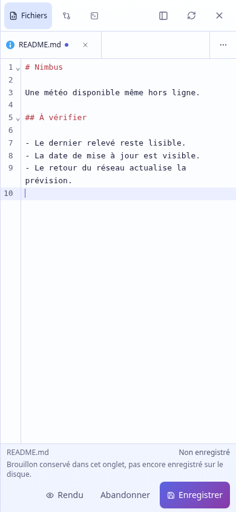

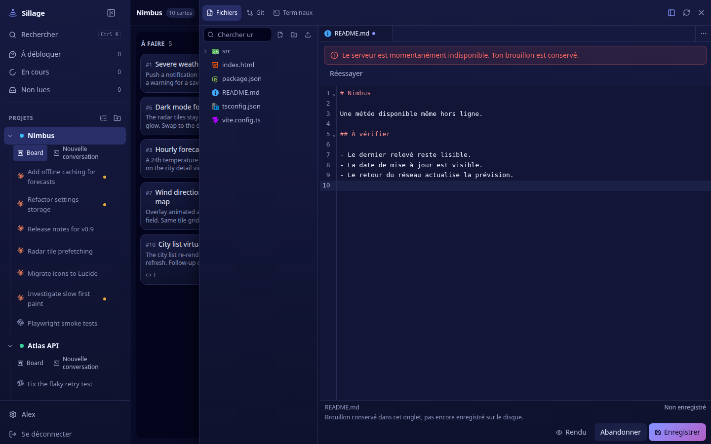

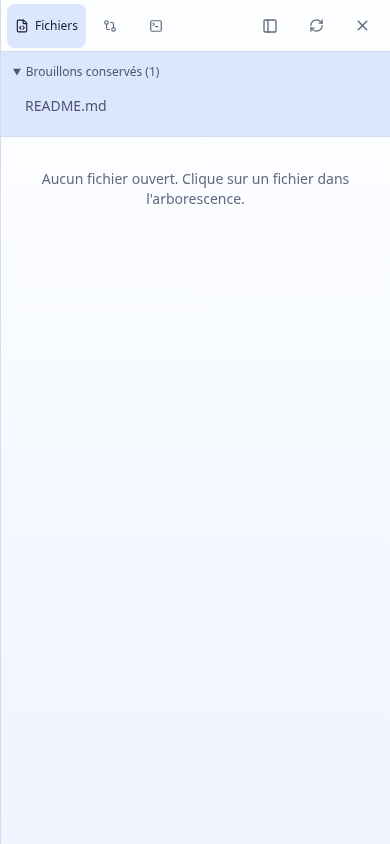

Validation: `scripts/checks/editor.mjs`, run by `pnpm test:ui`, uses temporary
workspace files and the real API. It covers tab changes, mobile recovery after
reload, write failure, slow saves followed by new typing, close/reopen during
save, real disk conflicts, both conflict resolutions, typing during slow reread,
storage denial, read error/recovery, and controls from 320 to 1440 px. Earlier
passes' tests continue passing.

Typecheck, build-integrated lint, production build, and `pnpm test:codex-ui` pass.
The isolated preview serves the compiled copy: HTTP 200 and build-identical index.
Screenshots and interactions were checked through Tailscale in light/dark and
desktop/mobile, without JavaScript exceptions. Separation between project drafts
and a conversation workspace was also checked. Screenshot errors are simulated;
no files were written on the demo server during these captures.

Recovery protects text, not undo history or cursor position across file changes.
Closing the browser tab ends draft retention in that tab. Existing limitations
for Safari, physical iPhone keyboard, and build warnings remain. This fourth pass
is available in preview; the main instance was not updated.

## Fifth pass: IDE navigation and comfort

This pass focuses on working across files. Additional findings were explorer
search squeezed by actions, same-named tabs hard to distinguish, loss of position
and undo history across files, and no true fullscreen from the board.

- Fullscreen uses the whole window and identifies project and current
  workspace/worktree. Available from board or conversation, it restores the
  previous layout without remounting editor or terminal. Escape outside the
  editor first exits fullscreen; the cross always closes the panel. Palettes and
  menus keep their own focus handling.
- “Open file” offers a current-workspace palette. ⌘P and Ctrl+P open it from Files.
  Without a query it offers open files and drafts; from two characters it searches
  names and paths. Arrows navigate, Enter opens, Escape closes. Partial results
  and errors are reported; errors can be retried. Selection opens the file and
  editor even when the tree covered it on mobile.
- Explorer search gets full width. Creation/import controls group above it.
  The active file is marked, and selecting it opens parent directories.
- The tab menu lists all open files with full paths. Same-named files also show
  directories in the bar. Arrows, Home, and End work on focused tabs. The active
  tab stays visible on selection and width changes, including explorer reopening.
- Cursor, selection, scroll, and Undo/Redo history survive across files,
  Markdown-render/source changes, and panel closure. One CodeMirror stays mounted:
  states live in memory, separated by account/workspace/file and capped at the
  latest 40 files. Reread versions replacing text invalidate old state. This
  continuity complements fourth-pass draft retention.
- Text search has a visible button. Displayed line/column position opens “Go to
  line” on click. Native CodeMirror commands remain available.

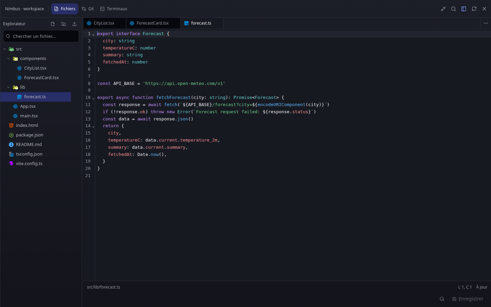

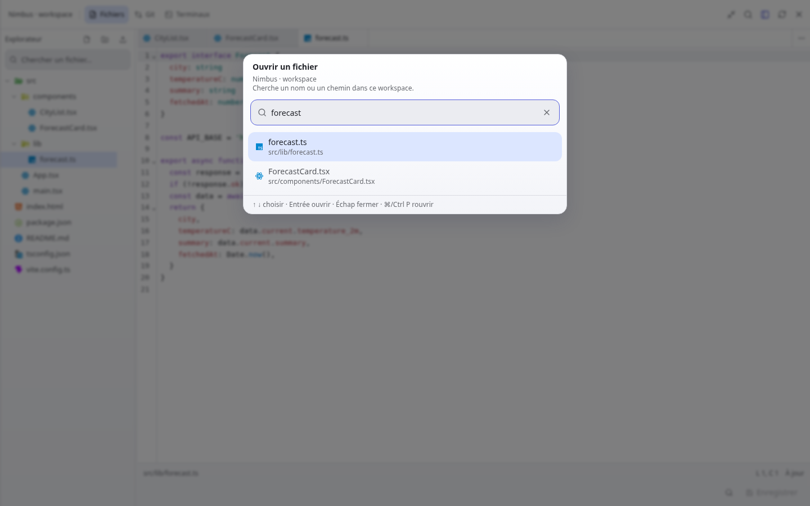

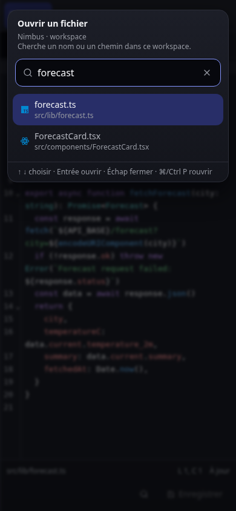

Validation: new `scripts/checks/ide.mjs`, run by `pnpm test:ui`, covers ⌘P/Ctrl+P,
keyboard selection, text search, line jump, selection/scroll after file changes,
Undo after file changes and panel closure, fullscreen without remounting, focus,
same-named tabs, their visibility after explorer reopening, search errors/recovery,
sizes from 320 to 1440 px, and preservation of the same terminal through fullscreen
and Git. The test terminal is created and closed in the temporary instance; no
command is run inside it.

All four earlier walkthroughs remain green. Typecheck, build-integrated lint,
production build, and `pnpm test:codex-ui` pass. Editing history and scroll are
in memory: they do not survive reload, unlike draft text within the same tab.
Shortcuts were exercised in Chromium; Safari on a physical Mac/iPhone remains
unchecked. Existing build warnings are unchanged.

The compiled frontend was copied to the isolated preview and checked through
Tailscale: HTTP 200, build-identical index, light/dark and mobile screenshots, no
JavaScript exceptions. Worktree labels were checked from a conversation. Captures
performed no file writes. The main instance was not updated.

## Sixth pass: downloading workspace files

- “Download” is available in explorer file overflow/context menus. A button near
  tabs also downloads the active file, including images, PDFs, and files the
  editor cannot open.
- Downloads retrieve the server-saved version. Drafts stay intact; the editor
  button says “Download saved version” when unsaved changes exist.
- The browser receives a direct stream, without the application assembling the
  entire file in memory. Binary files and files exceeding editor limits are
  accepted; original names, including accents, are preserved. Files are served
  as downloads, never interpreted as pages.
- The route follows project permissions and the conversation's worktree.
  Directories, external paths, and symlinks outside the workspace are rejected.

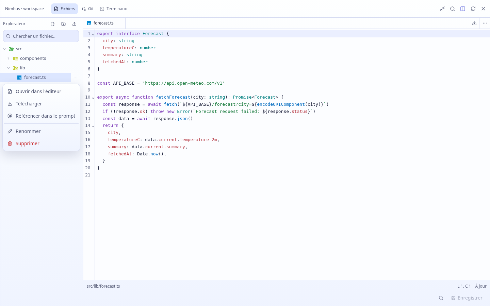

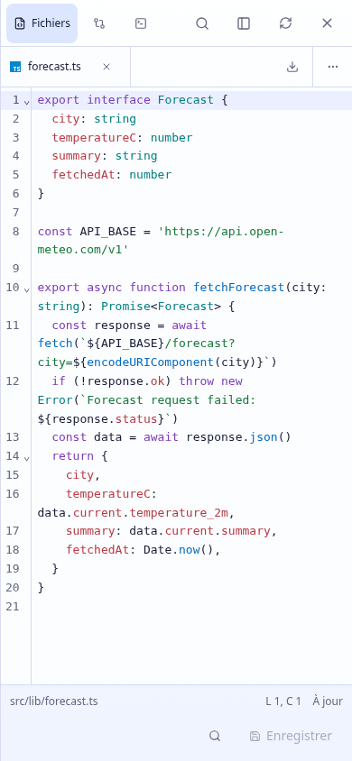

Validation: `scripts/checks/downloads.mjs`, part of `pnpm test:ui`, checks received
bytes and Chromium's suggested filename from both menus and the editor. It covers
binaries above 3 MB, names with accents/reserved characters, image, PDF, HTML,
empty file, preserved drafts, accessible buttons from 320 to 390 px, worktree
scope, missing files, directories, named pipes, and external paths/links. The full
walkthrough also checks rejection without sign-in or from another private account.
The test's language script is now restricted to the main application page: it no
longer tries writing to the PDF viewer's unavailable storage.

All UI walkthroughs pass, along with web/server typechecks, lint, and builds. The
isolated preview received the compiled frontend and its server restarted to load
the new route. Tailscale checks: HTTP 200, build-identical index, real desktop/mobile
downloads with exact names/content, no browser exceptions. Captures and checks
modified no preview workspace files. The main instance was neither restarted nor updated.

## Seventh pass: sidebar project headers

The “Board / New conversation” pair beside the title is removed. Project names
keep their weight and dot, with a neutral background. “Board” has a navigation
line below the header; a “+” button creates conversations from the header even
when collapsed. Its accessible label and tooltip identify the project.

Groups and conversations have more space from actions. On touchscreens, header
chevron and actions have 44 px targets; the project menu remains visible. Clicking
the title retains the per-project remembered destination.

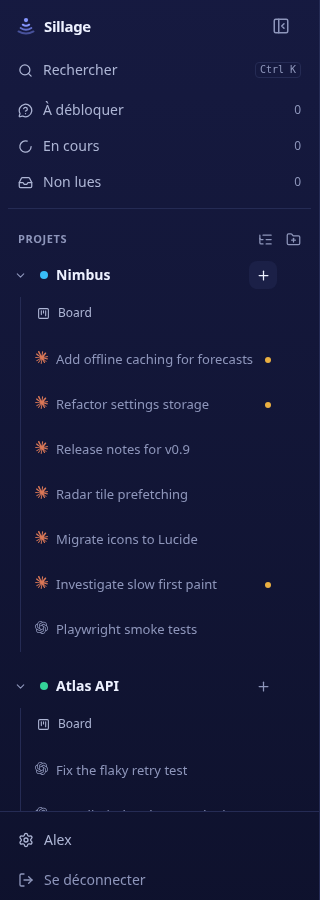

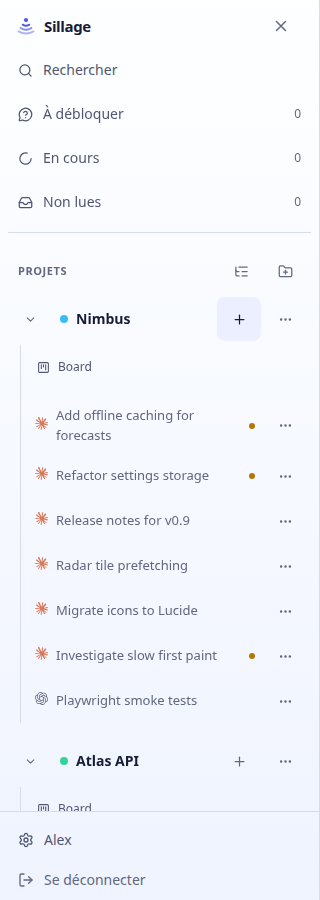

Validation: `pnpm test:ui`, web typecheck, lint, build pass. Preview build returns
HTTP 200 with a build-identical index. Board and “+” links were exercised by click
and keyboard, with mobile drawer closure after navigation. Screenshots and checks
show no overflow for sidebar widths 200, 320, 480 px and phones 320/390 px;
touch menu and light/dark themes checked. No browser exceptions. Main instance unchanged.

## Eighth pass: favorite repair

The defect was reproduced after opening a conversation: clicking “Favorite” sent
no mutation request, and saved value stayed false. Instruction cache shared the
conversation-list prefix. Optimistic updates therefore tried calling `map` on
`{ files }` and failed before reaching the server. Instructions now have a
separate cache key, also separating them from read-cursor updates.

- Favorite mutation lives in the sidebar and is shared by both conversation
  appearances. Actions disable during saving; errors remain visible even when
  optimistic removal hides the row from Favorites.
- Failures show message, reason, and “Retry”. Rollback restores only the favorite
  without undoing intervening read/status updates.
- Nondraggable rows no longer receive disabled drag attributes: `aria-disabled`
  also made their links/buttons inaccessible to assistive interactions.
  Favorite and archive rows stay navigable.

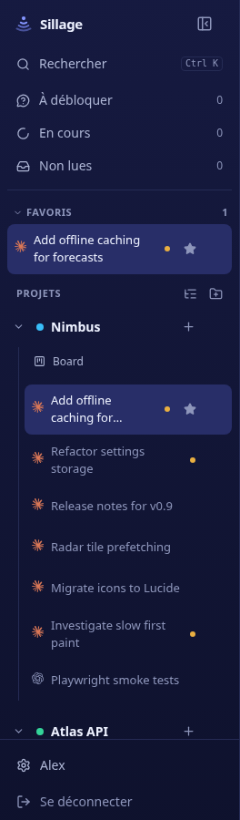

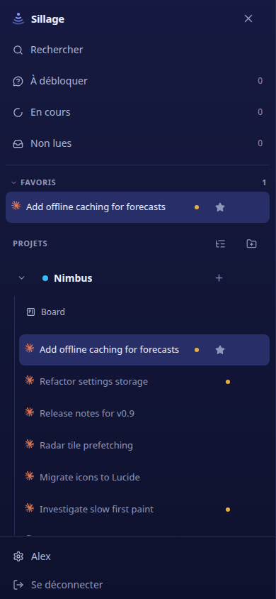

Validation: `scripts/checks/favorites.mjs` checks preloaded instructions, deliberately
slow add requests, synchronization of both occurrences, persistence after reload,
removal from favorites, add/remove failures and recovery, and mobile use. All
`pnpm test:ui` walkthroughs, web typecheck, lint, build pass. A fullscreen test wait
was refined to check translation completion before measuring position.

Preview build checked through Tailscale: HTTP 200 and identical index. The original
reproduction now emits PUT, persists the favorite, and shows both stars. An extra
check confirms persistence after reload and removal from the mobile section,
without browser exceptions. The demo favorite's initial state was restored.
The main instance remains unchanged.
