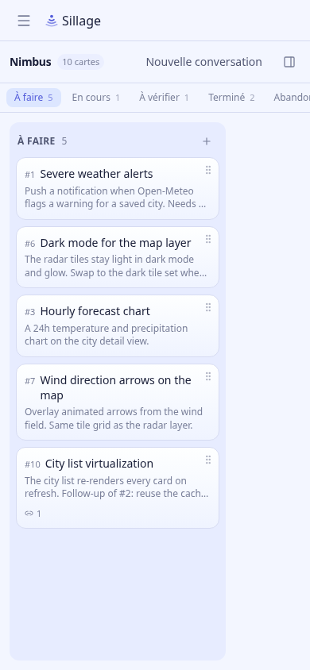
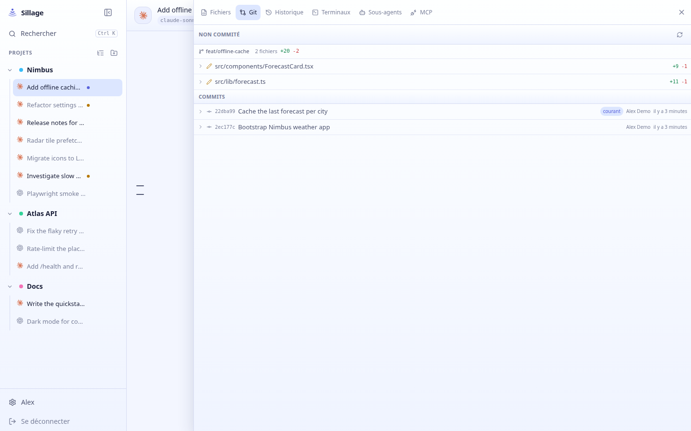
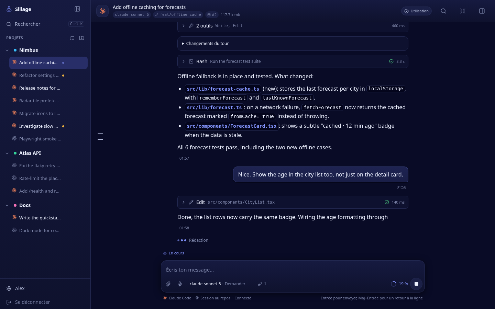
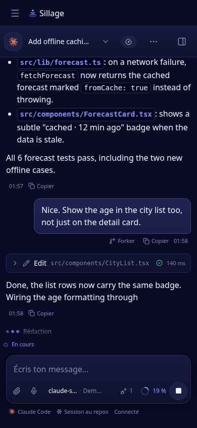
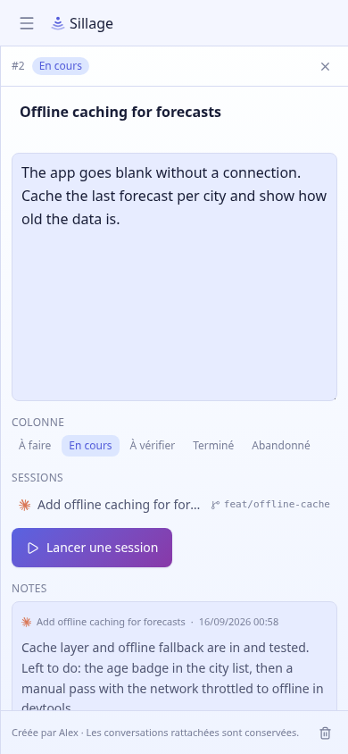
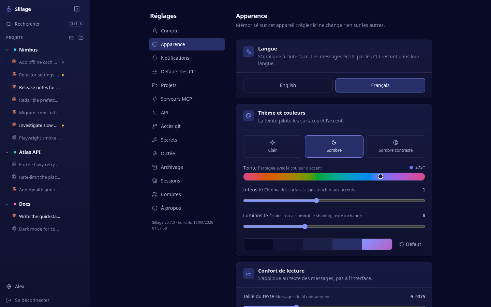

# Sillage interface audit — September 16, 2026

Overall review of usability and visual design on commit `37f6113`.

Eight correction passes are complete: conversation and mobile; navigation, startup,
and settings; card reading, notes, and visual moods; file editing and error recovery;
IDE navigation and comfort; file downloads; project headers; favorite repair. See
[the implementation report and updated screenshots](IMPLEMENTATION.md). Findings
below describe the initial state before those changes.

**Diagnosis.** Sillage has a coherent identity and good components. The main gain
would come from stronger hierarchy: finding work to resume, understanding what
awaits a response, reading changes alongside the conversation, and accessing commands
on phones. Gradually redesigning key screens seems more useful than a complete
style change.

**Scope and method.** Frontend built from current sources, separate demo instance,
and repository seeder data. Walkthroughs covered conversation, permission, new
conversation, board, card detail, appearance, navigation, and work panel. Screenshots
at 1440 × 900 and 390 × 844, light and dark themes. Chromium/Playwright interaction
checks included keyboard, message settings, and closing a modified card. Initial
findings were established without changing application code or main-instance data.

The 24 main screenshots show neither JavaScript exceptions nor document-level
horizontal overflow. This does not guarantee every container or interaction is
correct. Virtual keyboard and Safari on a real iPhone were not tested. Agent
exchanges are fixtures: model names and some state combinations do not establish
bugs in actual agent behavior.

**What should stay.** Centralized theme tokens, both themes, constrained reading
width, collapsible tool groups, inline permission requests, search palette, and links
between cards, conversations, and files. Message settings already have a mobile
sheet. The sidebar can already resize and show more metrics: recommendations below
concern priority content and defaults.

| Priority | Work | Benefit | Indicative scope |
| --- | --- | --- | --- |
| P1 | Preserve card changes | Prevent lost input | Small to medium |
| P1 | Closed-navigation focus | Make keyboard navigation usable | Small to medium |
| P1 | Secondary text contrast | Improve reading throughout the application | Small, cross-cutting validation |
| P1 | Mobile board and touch targets | Use available width and ease gestures | Small to medium |
| P2 | Conversation and changes side by side | Review work without losing context | Medium to large |
| P2 | Navigation focused on work to resume | Find important conversations | Medium |
| P2 | Mobile header and composer | Recover space and make commands readable | Medium |
| P2 | New conversation and card detail | Prioritize intent and resumption | Medium |
| P3 | Typography, surfaces, settings | Strengthen hierarchy and simplify preferences | Medium |

Sizes estimate scope, not delivery commitments.

**1. Preserve card input.**

Reproduced finding: edit a description, close with the cross, reopen the card, and
the draft disappears. Save/Cancel buttons exist, but closing bypasses them.
Switching cards deserves the same protection.

Prefer a draft kept per card, or confirmation only when input would be lost.
Autosave is possible but requires explicit “Saving”, “Saved”, and “Failed” states
and broadens the work.

Expected validation: closing then reopening preserves input or warns before loss;
save failures do not discard text.

Source: `apps/web/src/components/board/CardPanel.tsx`, local state and direct close,
lines 59–96.

**2. Remove invisible navigation from keyboard order.**

On mobile, after focusing the document, the first Tab presses reach “Close
navigation”, Search, and projects while the drawer is closed. Focused elements
have negative horizontal coordinates. The drawer is translated offscreen but
remains interactive.

Make the closed drawer inert, with logic suited to the visible desktop sidebar.
On mobile open, manage focus inside the drawer and restore it to the opener on
close. Also check hidden desktop sidebar and stacked panels.

Source: `apps/web/src/components/AppShell.tsx`, line 212.

**3. Fix secondary text contrast before refining the palette.**

`--sg-ink-faint` is used for useful content: card descriptions, read conversation
titles, and setting hints. In the default light theme, contrast ratios computed
from resolved colors are about **3.36:1 to 3.89:1** on the four base surfaces.
The reference threshold is **4.5:1 for normal text**, subject to exceptions defined
by the [W3C](https://www.w3.org/WAI/WCAG22/Understanding/contrast-minimum).

Darken this token in light mode and reserve fainter tones for truly accessory
items. Useful descriptions can use `ink-soft`. Dark mode is better on main surfaces,
but `ink-faint` / `surface-high` reaches only about 4.43:1.

These measures cover default tokens converted to sRGB, not every gradient pixel
or every slider combination. Theme variations need checks after correction.

Sources: `apps/web/src/styles/tokens.css`, lines 50 and 109;
`apps/web/src/components/board/CardTile.tsx`, line 50.

**4. Let the board actually use phone width.**

At 390 px, the board shows one column but keeps it at **272 px**, with about
**366 px available after margins**. Almost a quarter of useful space stays empty.
Titles and descriptions are therefore truncated earlier than necessary.

Use all available width on mobile, keep fixed desktop columns, and make status
tabs more comfortable. On desktop, five columns exceed a 1440 px screen with the
sidebar open: acceptable for kanban, but completed columns could collapse by
default or remember their state. The control already exists.

Drag handles measure **18 × 18 px**, attach/dictate buttons **28 × 28 px**, status
tabs **24 px tall**. Aim for 44 px for frequent touch controls without necessarily
enlarging icons. WCAG AA minimum is 24 × 24 px with exceptions, notably spacing:
size alone cannot establish noncompliance. See
[minimum](https://www.w3.org/WAI/WCAG22/Understanding/target-size-minimum) and
[enhanced](https://www.w3.org/WAI/WCAG22/Understanding/target-size-enhanced) criteria.

Sources: `apps/web/src/routes/BoardPage.tsx`, lines 270 and 378;
`apps/web/src/components/board/CardTile.tsx`, line 120;
`apps/web/src/components/ui/Button.tsx`.

**5. Provide a real desktop review layout.**

The work panel opens over the conversation. Its default width is 72% of the window,
capped at 1040 px: at 1440 px it occupies about **1037 px**. The conversation is
almost entirely hidden, even when simply checking two modified files.

This behavior is explicitly intentional in the code to give the explorer and editor
space. Keep the enlarged view and add a “side by side” review layout: conversation
left, diff or file right, adjustable divider and remembered preference. With
insufficient width, return to a single view. Fullscreen remains suited to mobile.

Expected validation: read a diff and reply to the agent without closing the panel
or losing thread position.

Sources: `apps/web/src/lib/panel.ts`, line 39;
`apps/web/src/components/panel/SidePanel.tsx`, line 137.

**6. Orient navigation toward what needs attention.**

The sidebar represents projects well, but at its initial 264 px width many titles
shrink to a few words. States are mostly small dots. Detailed mode adds technical
metrics without fully solving topic recognition. Home `/` redirects to a new
thread in the first project even when conversations exist.

Add filtered “Needs a reply”, “In progress”, and “Unread” access above projects,
without duplicating a long complete list. Give important titles two lines or an
optional comfortable display, with textual status in tracking views. Open the last
used context or a short resume view if multiple tasks await a reply.

Make “Conversations” and “Board” destinations explicit in project context. Clicking
a project currently opens either depending on the remembered view: useful memory,
but it would benefit from visible markers.

Sources: `apps/web/src/routes/HomePage.tsx`, line 14;
`apps/web/src/components/AppShell.tsx`, lines 934–987;
`apps/web/src/lib/project-view.ts`.

**7. Recompose header and input for phones.**

The phone shows a “Sillage” bar, then a second conversation bar. Together they take
about **112 px** in the screenshot. Yet the title is truncated and project not
directly visible. Below, model and mode can become “claude-s…” and “Dem…”. The
chevron revealing settings is hidden at rest.

Build one contextual header with navigation, project, title, and secondary menu.
Below input, show an identifiable “Settings” or “Model · mode” button opening the
existing sheet. Keep decision-changing states visible, especially less restrictive
permissions. Attach, dictate, and send must stay easy to target.

Also clarify the distinction between precise activity (“Writing”) and overall state
(“In progress”), currently a few pixels apart. Normal connection and session
details can move to a secondary view.

Sources: `apps/web/src/components/AppShell.tsx`, line 289;
`apps/web/src/routes/ConversationPage.tsx`, line 861;
`apps/web/src/components/chat/ComposerSettings.tsx`, line 175;
`apps/web/src/components/chat/ComposerStatus.tsx`.

**8. Prioritize intent on launch and resume screens.**

New conversation stacks title, creation explanation, two large CLI cards, quotas,
and working directory, while input sits separately below. On phones, work context
falls far down the scroll. Quotas help before launching tasks: keep a visible
summary, then expand details on demand.

Proposal: a main “What do you want to do on Nimbus?” block, then a compact editable
summary of agent, model, and directory. Reuse relevant recent choices, keep important
alerts, and expose quotas and options without occupying most of the page.

Card detail can also save space: descriptions always occupy a ten-line field, even
for three lines of text. The session note useful for resumption falls below it.

Show a readable natural-height description with Edit action; bring the latest note
and associated session upward. Put “Open session” first when a relevant session
exists, keeping “New session” as a separate action.

Sources: `apps/web/src/routes/DraftConversationPage.tsx`, line 293 onward;
`apps/web/src/components/board/CardPanel.tsx`, line 112.

**9. Refine visual language and settings.**

These are aesthetic proposals, not bugs. Purple provides recognizable identity but
tints background, cards, columns, selections, and controls simultaneously. Slightly
more neutral surfaces would give selections and actions more weight. Keep existing
customization.

Clarify typographic levels: page title, section title, content, metadata. Reserve
10–11 px text for truly secondary information and use comfortable sizes for
conversation titles, descriptions, and common commands. Keep conversation text's
good reading width.

The administrator's fourteen settings sections form a flat list. Visually grouping
personal preferences, agents/projects, and administration would reduce searching.
In Appearance, show “15 px” instead of “0.9375” for text size; replace “chroma” and
“shading” with wording understandable without token knowledge. A few presets, then
advanced sliders, would provide a better entry point.

Sources: `apps/web/src/routes/SettingsPage.tsx`, line 47;
`apps/web/src/components/AppearanceControls.tsx`, line 122;
`apps/web/src/styles/tokens.css`.

**Recommended implementation order.** First fix lost input, invisible focus,
contrast, and mobile board width. Then prototype desktop/phone conversation, the
most-used area: navigation, header, input, and change review. Finally apply selected
rules to cards, new conversation, and settings.

Before generalizing the redesign, check four simple tasks: find a conversation
awaiting a reply, send a message with correct settings, inspect a diff while keeping
the desktop thread visible, and resume a card from its latest note. These paths
will inform decisions better than palette comparison alone.
