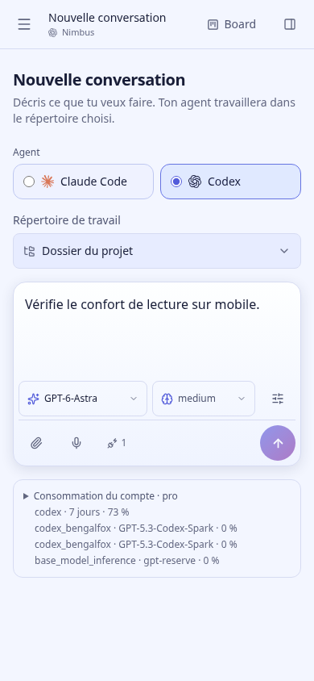
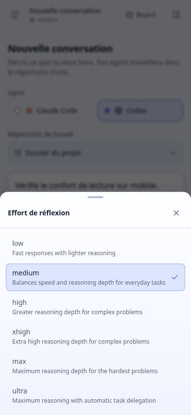
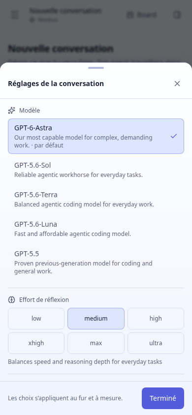
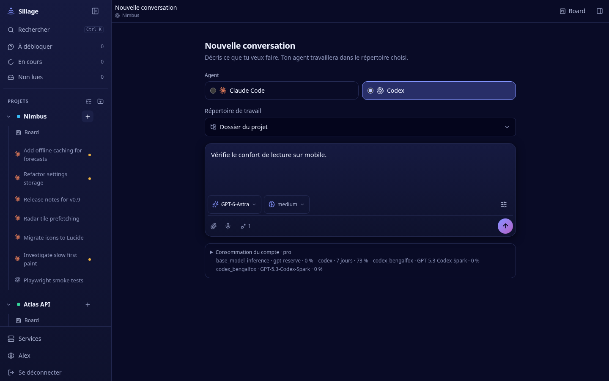
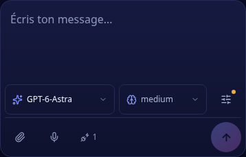
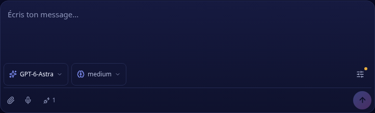

# Composer settings integration

The proposal was accepted on September 17, 2026. The user mostly changes model
and effort; both settings now have direct access with values readable on mobile.
Choosing takes two interactions. The complete view stays open between changes,
presenting options without subpages, followed by MCP controls.

[Try the integrated version through Tailscale](http://marldev.tail710c78.ts.net:7521/)
— demo account `alex`, password `sillage-demo`.

The catalog, available levels, and fallbacks still come from `useAgentSettings`.
Saved values outside the catalog remain readable. Search appears above eight models.
Models without effort hide its shortcut; model changes preserve or adapt effort
according to capabilities. Claude/Codex-specific permissions, indications of still
applied configuration, and the external MCP inventory are preserved.

Expanded permissions and Plan mode are indicated by a small dot on the settings
button, without an extra row below model and effort. Details remain in the panel,
on hover, and in the button's accessible label.

On phones, sheets follow visual viewport height, including keyboard shrinkage.
Shortcuts and options have a minimum height of 44 px. Closing returns focus to the
trigger; on desktop, mouse selection resumes existing typing at the same cursor.
Arrows, Home, and End navigate options; Enter or Space selects and Escape closes.

## Rapid changes and saving

The previous flow waited for a conversation reread before showing the new
configuration. Two rapid changes could therefore start from the same old
configuration and overwrite each other. `useConversationConfig` displays choices
immediately and orders writes per conversation, even across page navigation.
Old responses do not replace newer choices.

Sending, steering, and running native commands from the composer wait for settings
to save. Failures preserve choices and input, with a “Retry” action in the composer
and full panel. A configuration that failed to save does not trigger message sending.

## Validation

- `pnpm test:composer-ui`: real components and real save queue, mocked API, no
  agents started. Checks both direct controls, multiple changes, slow responses,
  write order, waiting before sending, errors and recovery, preserved drafts,
  agent-specific rules, and MCP. Also checks a long catalog, saved model outside
  the catalog, uneditable granular approval, conversation change during save,
  focus, resizing, and keyboard-reduced viewport.
- Sizes exercised: 1440 × 900, 390 × 844, 320 × 640, and 667 × 375. No horizontal
  overflow or browser exceptions on these paths.
- Expanded permissions and Plan mode no longer increase composer height; their
  details remain announced by the settings button. Also checked on the compiled
  preview at 390 and 1440 px.
- `pnpm test:ui` and `pnpm test:codex-ui` pass, as do web typecheck and lint.
- Production build in `/tmp/sillage-composer-app/web`. Existing warnings about
  `::highlight`, CodeMirror, and bundle size remain.
- Compiled preview checked with the real catalog in light and dark themes.
  Visual-check interactions stay in a new unsent conversation. HTTP 200 and served
  index identical to the build.

The keyboard and Safari on a physical iPhone remain untested. Viewport simulation
does not replace this check.

## Preview

User unit `sillage-composer-app-preview` serves the compiled frontend at
`127.0.0.1:7521` through Vite preview. API and WebSockets point to the existing demo
instance on port 7519 with its separate database. The original mockup stays on 7520.

The compact interface was deployed to the main instance on September 17, 2026, at
02:53 (Paris), without restarting the server. The tested build atomically replaces
the web directory; old assets remain for open tabs. The 40 files checked through
the public URL match the build, and the server PID is unchanged. Provenance and
rollback directory are recorded in `~/.local/share/sillage/app/deployed-composer-web.json`.

To remove this preview:

```sh
systemctl --user stop sillage-composer-app-preview
sudo tailscale serve --http=7521 off
```












