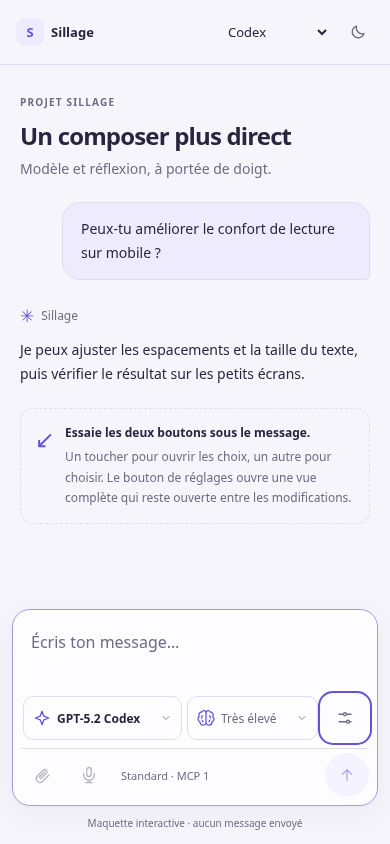
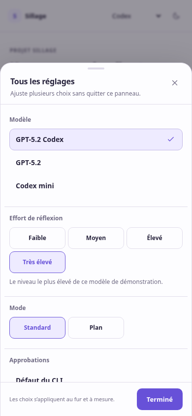
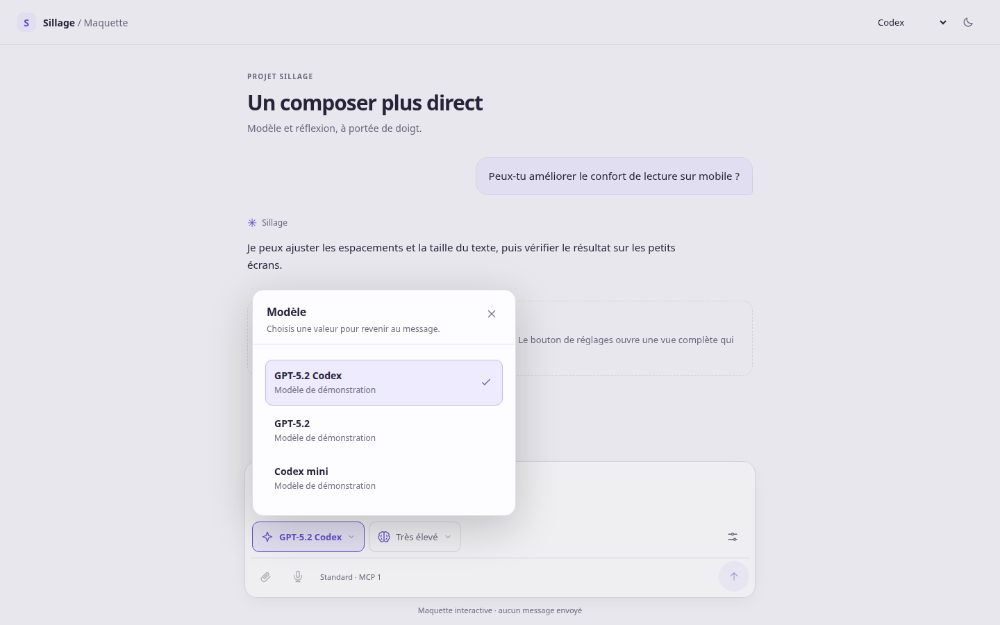

# Composer settings proposal

Standalone mockup from September 17, 2026, prepared after reviewing the current
composer. The user mostly changes **model and reasoning effort**. Once approved,
this interaction was integrated into the frontend: see the
[integration report](IMPLEMENTATION.md).

[Open the private mockup through Tailscale](http://marldev.tail710c78.ts.net:7520/).

## Proposed interaction

- Two buttons always show model and effort below the message, including on phones.
  Tapping a button opens its values directly; selecting applies and closes.
  **Two interactions instead of three** per setting, four instead of six to change both.
- “All settings” opens a view without subpages that stays open during changes:
  model, effort, agent-specific mode and permissions, then MCP. Changes apply on
  each choice; “Done” simply closes the panel.
- On phones, selectors are bottom sheets. Controls have targets of at least 44 px;
  both shortcuts stay visible without horizontal scrolling. Long panel content
  scrolls between a fixed header and footer.
- On desktop, the panel anchors to its button. Arrows navigate choices, Enter or
  Space selects, Escape closes.
- Draft text stays present. On phones, closing a panel returns focus to its button
  to avoid opening the keyboard; on desktop, existing typing resumes at the same position.
- “Plan”, “Full access”, “Approvals: never”, and “Allow everything” remain readable
  in the composer when selected.








## Mockup scope

`index.html`, `prototype.css`, and `prototype.js` work without dependencies.
Models, levels, and MCP servers are illustrative. Choices live only in page memory;
no request reaches a Sillage API or agent. Sending, attachments, and dictation are
disabled. Agent menu and theme switching allow comparing renderings.

For integration, keep the data and rules from `useAgentSettings` in
`apps/web/src/components/chat/agent-settings.tsx`: real catalog, available levels,
effort fallback on model changes, saved values, and distinction between selected
and applied configuration. Quick access would go in `ComposerSettings.tsx`, and
`SettingsPanel.tsx`'s two-level panel would become a flat view. Claude and Codex
permissions keep their differences. The MCP inventory also retains the distinction
between Sillage-managed and external servers.

## Verification

Playwright walkthrough in Chromium on desktop at 1440 px and mobile emulation at
390 and 320 px: quick choices and dismissal, successive changes in the full panel,
model-dependent levels, hiding ineffective settings, preserved drafts, visible
permission states, light/dark themes, and no horizontal overflow. Quick buttons
measure at least 44 × 44 px. Additional checks cover arrows, Enter, Escape, Tab,
Shift+Tab, preserved desktop text selection, focus return, and landscape at
667 × 375 px. No JavaScript exceptions on these paths.

Safari on a physical iPhone and its virtual keyboard remain untested. This
validation covers the mockup, not its integration with real configuration updates.

## Preview service

Temporary user unit `sillage-composer-preview`, Python server bound to
`127.0.0.1:7520`, root limited to this directory. Tailscale exposure is private.
HTTP response and served content checked with `curl` and `cmp`.

To remove the preview:

```sh
systemctl --user stop sillage-composer-preview
sudo tailscale serve --http=7520 off
```
